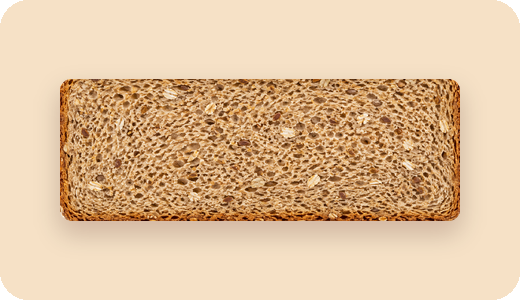
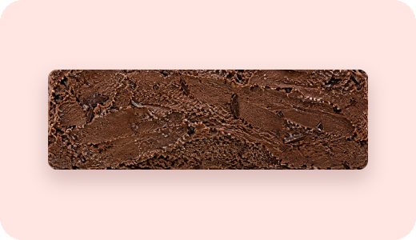
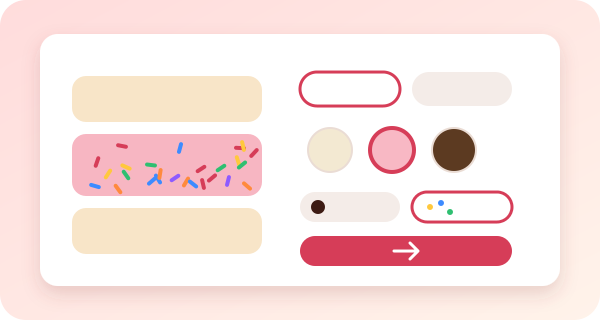
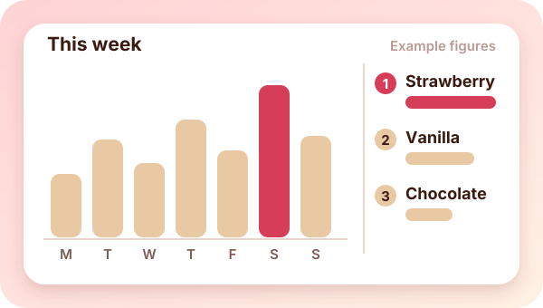

<div align="center">


<a href="https://github.com/vassellenha/KWU-BRREAD/actions/workflows/ci.yml"></a>

<br />

<a href="#build-it-layer-by-layer"></a>
<a href="#staff-manual"></a>
<a href="#run-it-locally"></a>




<sub><a href="#what-it-is">What it is</a> &nbsp;·&nbsp; <a href="#build-it-layer-by-layer">Builder</a> &nbsp;·&nbsp; <a href="#features">Features</a> &nbsp;·&nbsp; <a href="#what-happens-at-checkout">Checkout</a> &nbsp;·&nbsp; <a href="#staff-manual">Staff manual</a> &nbsp;·&nbsp; <a href="#tech-stack">Tech stack</a> &nbsp;·&nbsp; <a href="#run-it-locally">Run it</a></sub>

</div>


## What it is

Brread! sells ice cream sandwiches: one slice of soft bread folded around a slab of ice cream, the way an Uncle cart does it on Orchard Road. Customers design each sandwich in a live builder and order it from the storefront.

The same app contains the back office. Staff sign in to a portal that tracks ingredient stock, employees, cash flow and sales, and every order a customer places feeds all four.

### From bread to doorstep

<div align="center">

</div>

<table>
<tr>
<td width="33%" valign="top">
<br />
<b>Pick your bread</b><br />
Plain white for the classic soft bite, or whole wheat for something heartier.
</td>
<td width="33%" valign="top">
<br />
<b>Slice your ice cream</b><br />
Vanilla, strawberry or chocolate, hand-sliced from a block.
</td>
<td width="33%" valign="top">
<br />
<b>Pack it cold</b><br />
Every order goes into insulated foil for delivery across Jakarta.
</td>
</tr>
</table>

### Meet the sandwiches

<div align="center">

</div>


## Build it layer by layer

<div align="center">

</div>

<sub>The loop above steps through six sandwiches, from Rp 14,000 (white bread and vanilla) to Rp 21,000 (wheat bread, chocolate, both toppings).</sub>

The builder stacks a photo of every ingredient you pick and shows the result as you go. **Exploded View** pulls the layers apart, and the signature combos fill a whole sandwich in one click.

<table>
<tr><th width="33%">Bread</th><th width="33%">Ice cream</th><th width="33%">Toppings</th></tr>
<tr>
<td valign="top" align="center"><br /><b>Plain White Bread</b><br />Rp 6,000</td>
<td valign="top" align="center"><br /><b>Vanilla</b><br />Rp 8,000</td>
<td valign="top" align="center"><br /><b>Chocolate Sauce</b><br />Rp 3,000</td>
</tr>
<tr>
<td valign="top" align="center"><br /><b>Whole Wheat Bread</b><br />Rp 7,000</td>
<td valign="top" align="center"><br /><b>Strawberry</b><br />Rp 8,000</td>
<td valign="top" align="center"><br /><b>Rainbow Sprinkles</b><br />Rp 3,000</td>
</tr>
<tr>
<td valign="middle" align="center"><b>24 combinations</b><br />2 breads × 3 flavors × 4 topping choices (none, either one, or both)</td>
<td valign="top" align="center"><br /><b>Chocolate</b><br />Rp 8,000</td>
<td valign="middle" align="center"><b>Rp 14,000 to Rp 21,000</b><br />per sandwich at the seeded prices</td>
</tr>
</table>

A sandwich takes exactly one bread and one ice cream, and each topping at most once.

### Flavor lab

Open a flavor to see what the seeded catalog says about it.

<details>
<summary><b>Vanilla</b></summary>
<br />
<table>
<tr>
<td width="40%" valign="top"></td>
<td valign="top">

Rp 8,000 per sandwich.<br />Seeded with **120** in stock and a reorder point of **40**.<br />The photo shows it on plain white bread.

</td>
</tr>
</table>
</details>

<details>
<summary><b>Strawberry</b></summary>
<br />
<table>
<tr>
<td width="40%" valign="top"></td>
<td valign="top">

Rp 8,000 per sandwich.<br />Seeded with **120** in stock and a reorder point of **40**.<br />The photo adds Rainbow Sprinkles, which are Rp 3,000 more.

</td>
</tr>
</table>
</details>

<details>
<summary><b>Chocolate</b></summary>
<br />
<table>
<tr>
<td width="40%" valign="top"></td>
<td valign="top">

Rp 8,000 per sandwich.<br />Seeded with only **35** in stock against a reorder point of **40**, so a fresh install shows a low-stock alert for it in MRP right away.<br />The photo shows it on whole wheat bread.

</td>
</tr>
</table>
</details>

<details>
<summary><b>Chocolate Sauce</b></summary>
<br />
<table>
<tr>
<td width="40%" valign="top"></td>
<td valign="top">

A Rp 3,000 topping, seeded with **300** in stock and a reorder point of **60**.<br />Each topping can be added once, and the sauce and the sprinkles can be combined.

</td>
</tr>
</table>
</details>


## Features

### Storefront

<table>
<tr>
<td width="50%" valign="top">
<br />
&nbsp; <b>Brread! Studio</b><br />
Pick a base, a flavor and toppings, and the preview updates live in 3D: drag to turn the sandwich a full 360°, zoom in on the crumb, or open the exploded view to see every layer. Ingredients unlock in order, so you can't build an invalid sandwich. On a phone the 3D preview sits first, with the step bar, signature combos and pickers below it, so a choice shows up without scrolling back.
</td>
<td width="50%" valign="top">
<br />
&nbsp; <b>Cart and checkout</b><br />
The cart survives a page refresh. An order records the customer's name and phone number, and the server charges current prices even if the cart is older.
</td>
</tr>
</table>

Five public pages: home (`/`), the builder (`/builder`), the full menu (`/menu`), the shop's contact details (`/contact`) and a short privacy note (`/privacy`). The privacy note says what checkout collects and why, and the cart drawer links to it right under the name and phone fields. Every page carries its own description plus Open Graph tags, so a shared link shows the `public/img/social-preview.jpg` card in WhatsApp and similar apps. Checkout asks the customer to confirm the name and phone number they typed before the order is placed. A custom `/404` page matches the site's look instead of Laravel's default error screen, and the ingredient images were re-encoded to WebP (about 80% smaller) to keep the builder fast on mobile.

### Staff portal

Every module opens with the same header (`resources/views/components/staff/page-header.blade.php`): an icon tile, the page title, a one-line description and, where it helps, a back link or an action button. Confirmations such as cancelling an order or removing an expense use an in-page dialog instead of the browser's own popup.

<table>
<tr>
<td width="50%" valign="top">
<br />
&nbsp; <b>MRP, ingredient stock</b><br />
Stock levels, reorder points and low-stock alerts for every ingredient. Restock or correct a count with a note. A restock cost becomes an expense in Accounting, and every change is kept in a movement history.
</td>
<td width="50%" valign="top">
<br />
&nbsp; <b>HR, people and duty rotation</b><br />
Add, edit and deactivate employees. A fixed rotation puts 3 active employees on duty for 3 days at a time and wraps around the list, so adding or reordering staff reshapes the schedule immediately. The seeded team is Rizky Sandi Pratama (Ketua) and eight members, nine people in all, which makes three duty teams of three. A migration swaps the early placeholder crew for this roster on existing databases and leaves anyone added by hand after them.
</td>
</tr>
<tr>
<td width="50%" valign="top">
<br />
&nbsp; <b>Accounting, cash flow</b><br />
Income arrives from orders, and staff log expenses by category. Choose a date range to see the opening balance, income, expenses and closing balance, then export the report and ledger to Excel.
</td>
<td width="50%" valign="top">
<br />
&nbsp; <b>Sales, what sells</b><br />
Best-selling combinations, rankings for breads, flavors and toppings (including the ones that never sold), trends by day, week or month against the previous period, and the busiest days and hours. Admin only.
</td>
</tr>
</table>


## What happens at checkout


The ingredient rows stay locked for the whole database transaction, so two customers racing for the last unit can't both get it. If an ingredient runs short, the customer sees how many are left. The order endpoint accepts 30 requests per minute per IP address, and the login forms accept 10 attempts per minute per username and IP address.


## Staff manual

### Sign in

| Portal | Address | Accounts |
|---|---|---|
| Staff | `/staff` | `staffmrp` (MRP), `staffhr` (HR), `staffacc` (Accounting) |
| Superadmin | `/superadmin` | `superadmin` |

Staff and admins use separate login pages, and an account only works on its own page. The seeded staff passwords are in [`docs/STAFF_LOGIN_GUIDE.md`](./docs/STAFF_LOGIN_GUIDE.md), and the admin password comes from the maintainer.

On `/superadmin`, a one-click admin login appears only when `APP_ENV=local` **and** the page is opened on `localhost` or `127.0.0.1`. A deployed copy never shows it, whatever the environment says, because anyone who could open the page would become an admin. The password is no longer sent to the browser.

**Superadmin account.** The admin account is named `superadmin`. A migration renames the old `admin` row in place on the first deploy, so its password and history carry over, and `ADMIN_PASSWORD` stays the variable that sets it (`SUPERADMIN_PASSWORD` works too and wins if both exist).

**Passwords in production.** The seeder runs on every deploy. It creates the four accounts if they are missing and leaves existing ones alone, so a changed password survives. To set or rotate them, define one variable per account in the host's variables: `ADMIN_PASSWORD`, `STAFFMRP_PASSWORD`, `STAFFHR_PASSWORD` and `STAFFACC_PASSWORD`; the next deploy applies them. `STAFF_PASSWORD` still works as a shared fallback for any staff account that has no variable of its own. If an account has no password variable in production, new accounts get a random password printed once in the deploy log. The documented defaults only apply to local environments.

**Sign-in check.** Both sign-in forms ask one small arithmetic question ("what is 7 + 4?"). The answer is kept in the session, checked before the password, and used up by the first attempt, so a script cannot replay it and a wrong answer reveals nothing about the credentials. It is on by default and `LOGIN_CAPTCHA=false` turns it off for local work; the test suite disables it except in its own tests. It stops simple scripts and works beside the rate limits below, but it is not a replacement for a service such as Cloudflare Turnstile if the site ever faces determined bots.

**Keeping dependencies current.** Dependabot (`.github/dependabot.yml`) opens a grouped pull request every week for Composer and npm packages and every month for GitHub Actions, and the `audit` job in CI runs `composer audit` and `npm audit` so a package with a published security advisory turns the build red. Outdated software is how most sites get breached, so merge those pull requests once the tests pass.

**Staff security habits.** Use your own account and never share it, keep the password unique to Brread!, sign out on any shared or public device (turn off "Keep me signed in" there), and tell the admin right away if a password was seen by someone else so it can be rotated through `ADMIN_PASSWORD` or the matching `STAFF*_PASSWORD` variable.

**Speed on a remote database.** Every page makes about 5 to 13 queries, plus session reads and writes, and each request opens its own database connection. When the app and the database sit in different regions, that adds up to seconds. Keep both in the same region (Railway Singapore with a Supabase project in Singapore). Setting `DB_PERSISTENT=true` reuses the Postgres connection between requests, and `SESSION_DRIVER=file` / `CACHE_STORE=file` keep session and cache reads off the database (sessions then end on every redeploy).

**Hardening in place.** Every response carries `X-Frame-Options`, `X-Content-Type-Options`, `Referrer-Policy`, `Permissions-Policy`, HSTS over HTTPS and a Content-Security-Policy (`app/Http/Middleware/SecurityHeaders.php`). Sign-in is rate limited, order input is validated on the server and prices are always recalculated there, and all user text is escaped on output. On Supabase, a migration turns row level security on for every table so the public API key cannot read the database; the app itself connects as the owner and is unaffected. Sign-in is throttled per account+address (10 a minute), per address (30 a minute), and per account alone regardless of address (20 every 10 minutes), so spreading login attempts across many IPs does not avoid the limit. The `X-Powered-By` header is stripped, and an order review can be written once and not replaced. A black-box pentest (November 2026: exposed files, headers, CORS, login abuse including a distributed/multi-IP brute-force check, SQL injection, XSS, CSRF, role access, price tampering, malformed order payloads, review abuse) is covered by `tests/Feature/PentestRegressionTest.php`, plus a live test against the deployed site that confirmed no SQL injection or auth bypass.

**Container hardening.** The production image (`Dockerfile`) runs nginx + php-fpm under supervisor instead of `php artisan serve`, which is Laravel's own development server and not meant to take production traffic. Every HTTP request is handled by an nginx and php-fpm worker running as the unprivileged `www-data` user (set by `chown` in the Dockerfile and php-fpm's own pool default), while the master processes still start as root only to bind the port and supervise their workers, so a bug in request handling never runs with root privileges. The Postgres connection also now defaults to `DB_SSLMODE=require` (`config/database.php`) instead of `prefer`, which would otherwise silently fall back to an unencrypted connection to Supabase if the TLS handshake had any trouble.

### What each role can open

| | &nbsp; MRP | &nbsp; HR | &nbsp; Accounting | &nbsp; Sales |
|---|:---:|:---:|:---:|:---:|
| &nbsp; **Admin** |  |  |  |  |
| **MRP staff** |  | | | |
| **HR staff** | |  | | |
| **Accounting staff** | | |  | |

The sidebar lists only the modules your role can open, and the URL of any other module returns a 403.

### Modules

<details>
<summary><b>MRP</b>: ingredient stock at <code>/staff/mrp</code></summary>

<br />

- The dashboard shows each ingredient's stock level, category, reorder point and status.
- A low-stock alert appears when an ingredient reaches its minimum.
- To restock or correct a count, adjust the stock and write a note. If you enter a restock cost, it is booked as an expense in Accounting.
- The full history of stock movements is at `/staff/mrp/movements`.
- Customer orders deduct stock automatically at checkout, so you never subtract those by hand.

</details>

<details>
<summary><b>HR</b>: employees and duty rotation at <code>/staff/hr</code></summary>

<br />

- Add, edit and deactivate employees from the directory.
- The duty rotation puts 3 active employees on shift for 3 days at a time. It follows the rotation order, so deactivating or reordering someone changes the schedule right away.

</details>

<details>
<summary><b>Accounting</b>: cash flow at <code>/staff/accounting</code></summary>

<br />

- Customer orders appear as money in, and the expenses you log appear as money out.
- To log an expense, pick a category: Ingredients, Utilities, Salaries, Equipment, Rent or Other. You can delete an expense you entered by mistake.
- Choose a date range to see the opening balance, income, expenses, closing balance and expenses by category.
- Export the report and ledger to an `.xlsx` file.

</details>

<details>
<summary><b>Sales</b>: what sells at <code>/staff/sales</code> (admin only)</summary>

<br />

- Best-selling combinations of flavor, bread and topping.
- Rankings for flavors, breads and toppings, including the ones that haven't sold yet.
- Sandwiches sold and revenue per day, week or month, compared with the previous period.
- The busiest days and hours.

</details>


## Tech stack

<b>Backend</b><br />
   

<b>Frontend</b><br />
    

The 3D sandwich runs on <b>three.js</b>, loaded as its own chunk only where it is shown: the home hero (three ready-made combos to flip through) and the Studio on `/builder`. Browsers without WebGL, or with data saver on, fall back to a photo. Any element with a `data-tip` attribute gets a tooltip on hover and keyboard focus (`initTooltips()` in `resources/js/app.js`). The storefront's handmade layer is plain CSS and SVG in `resources/css/app.css`: a drifting sprinkle wallpaper (`.doodle`), melting section edges (`partials/drip.blade.php`), taped polaroids for customer photos, and a two-second entry intro that plays once per browser session and is skipped under `prefers-reduced-motion`. The About page (`/about`) is a long scroll story: <b>Lenis</b> smooths the scrolling and `resources/js/about.js` drives the pinned chapters, the sideways strip and the 3D sandwich from scroll position; it loads only on that page and the page stays readable without it. The scrollbar is custom (`initScoopbar()` in `resources/js/app.js`): a small ice cream sandwich that rides the right edge and leaves a melted trail. With a mouse it is always there and the whole rail drags; on touch screens a smaller one appears while the page moves, can be dragged by the sandwich, and fades out when scrolling stops. On phones the drips render at two-thirds size and their droplets are clipped to the viewport, so nothing widens the page. Ingredient cut-outs for the Menu and About pages live in `public/img/cutout/`.

<b>Data</b><br />
  

<b>Quality</b><br />
 

<b>Deploy</b><br />


The Dockerfile builds the assets, migrates, seeds and serves the app.


## Run it locally

You need PHP 8.3 with the `sqlite`, `zip` and `gd` extensions, Composer 2 and Node.js 22.

<div align="center">

</div>

The same commands, ready to copy:

```bash
git clone https://github.com/vassellenha/KWU-BRREAD.git
cd KWU-BRREAD

composer install
npm install
cp .env.example .env
php artisan key:generate

touch database/database.sqlite
php artisan migrate --seed
npm run build

php artisan serve
```

| | |
|---|---|
| Storefront | http://127.0.0.1:8000 |
| Staff portal | http://127.0.0.1:8000/staff |
| Admin portal | http://127.0.0.1:8000/superadmin |

While you work on the frontend, run `npm run dev` in a second terminal instead of `npm run build`.

**Shortcuts.** On macOS, Linux or WSL, `make setup` runs the whole block above and `make` lists the rest (`make serve`, `make test`, `make fresh`, `make docker`). On Windows PowerShell, `powershell -ExecutionPolicy Bypass -File scripts\setup.ps1` does the same setup and stops with a clear message if PHP, Composer or Node is missing.


## Run it with Docker

```bash
docker build -t brread .
docker run -p 8080:8080 -e APP_KEY="base64:$(openssl rand -base64 32)" brread
```

Open http://localhost:8080. The container migrates and seeds the database every time it starts, and it listens on the port in the `PORT` variable (8080 by default). The data lives in a SQLite file inside the container, so it resets when you replace the container.


## Tests

```bash
php artisan test
```

GitHub Actions (`.github/workflows/ci.yml`) builds the assets and runs the suite on every push to `main` and on every pull request, and the badge at the top shows the result.

The feature tests cover both login portals, role access, ordering with stock deduction, and the MRP, HR, accounting and sales modules.


## Project layout

```text
app/
  Http/Controllers/Api/      public API: components and orders
  Http/Controllers/Staff/    login and the MRP, HR, accounting and sales modules
  Models/                    Component, Order, OrderItem, StockMovement, Employee, Expense, User
  Services/                  CashflowExporter, SalesReport, ShiftScheduler
database/                    migrations and seeders
resources/views/             storefront pages, staff portal, shared partials
resources/js/studio3d.js     the Studio's 3D scene: slab models, toppings, lighting, orbit controls
public/img/studio3d/         baked PBR textures (colour and normal maps) for breads and ice creams
scripts/                     build_studio3d_textures.py re-bakes those textures from public/img/ingredients; setup.ps1 is the Windows setup
Makefile                     shortcuts: make setup, serve, test, fresh, docker
.github/workflows/ci.yml     CI: asset build and the PHPUnit suite
routes/                      web.php and api.php
docs/                        staff guide
tests/                       feature and unit tests
```


## Author

Built by [Vassell Enha Atthayya](https://github.com/vassellenha).

<div align="center">

</div>
