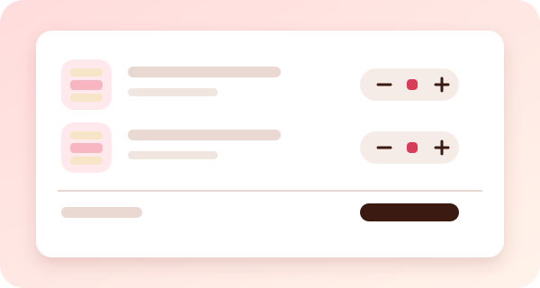

<div align="center">


<a href="https://github.com/vassellenha/KWU-BRREAD/actions/workflows/ci.yml"></a>

<br />

<a href="#build-it-layer-by-layer"></a>
<a href="#staff-manual"></a>
<a href="#run-it-locally"></a>


<sub><a href="#what-it-is">What it is</a> &nbsp;·&nbsp; <a href="#build-it-layer-by-layer">Builder</a> &nbsp;·&nbsp; <a href="#features">Features</a> &nbsp;·&nbsp; <a href="#what-happens-at-checkout">Checkout</a> &nbsp;·&nbsp; <a href="#staff-manual">Staff manual</a> &nbsp;·&nbsp; <a href="#tech-stack">Tech stack</a> &nbsp;·&nbsp; <a href="#run-it-locally">Run it</a></sub>

</div>


## What it is

Brread! sells ice cream sandwiches: one slice of soft bread folded around a slab of ice cream, the way an Uncle cart does it on Orchard Road. Customers design each sandwich in a live builder and order it from the storefront.

The same app contains the back office. Staff sign in to a portal that tracks ingredient stock, employees, cash flow and sales, and every order a customer places feeds all four.

### From bread to doorstep

<div align="center">

</div>

<table>
<tr>
<td width="33%" valign="top">
<br />
<b>Pick your bread</b><br />
Plain white for the classic soft bite, or whole wheat for something heartier.
</td>
<td width="33%" valign="top">
<br />
<b>Slice your ice cream</b><br />
Vanilla, strawberry or chocolate, hand-sliced from a block.
</td>
<td width="33%" valign="top">
<br />
<b>Pack it cold</b><br />
Every order goes into insulated foil for delivery across Jakarta.
</td>
</tr>
</table>

### Meet the sandwiches

<div align="center">

</div>


## Build it layer by layer

<div align="center">

</div>

<sub>The loop above steps through six sandwiches, from Rp 14,000 (white bread and vanilla) to Rp 21,000 (wheat bread, chocolate, both toppings).</sub>

The builder stacks a photo of every ingredient you pick and shows the result as you go. **Exploded View** pulls the layers apart, and the signature combos fill a whole sandwich in one click.

<table>
<tr><th width="33%">Bread</th><th width="33%">Ice cream</th><th width="33%">Toppings</th></tr>
<tr>
<td valign="top" align="center"><br /><b>Plain White Bread</b><br />Rp 6,000</td>
<td valign="top" align="center"><br /><b>Vanilla</b><br />Rp 8,000</td>
<td valign="top" align="center"><br /><b>Chocolate Sauce</b><br />Rp 3,000</td>
</tr>
<tr>
<td valign="top" align="center"><br /><b>Whole Wheat Bread</b><br />Rp 7,000</td>
<td valign="top" align="center"><br /><b>Strawberry</b><br />Rp 8,000</td>
<td valign="top" align="center"><br /><b>Rainbow Sprinkles</b><br />Rp 3,000</td>
</tr>
<tr>
<td valign="middle" align="center"><b>24 combinations</b><br />2 breads × 3 flavors × 4 topping choices (none, either one, or both)</td>
<td valign="top" align="center"><br /><b>Chocolate</b><br />Rp 8,000</td>
<td valign="middle" align="center"><b>Rp 14,000 to Rp 21,000</b><br />per sandwich at the seeded prices</td>
</tr>
</table>

A sandwich takes exactly one bread and one ice cream, and each topping at most once.

### Flavor lab

Open a flavor to see what the seeded catalog says about it.

<details>
<summary><b>Vanilla</b></summary>
<br />
<table>
<tr>
<td width="40%" valign="top"></td>
<td valign="top">

Rp 8,000 per sandwich.<br />Seeded with **120** in stock and a reorder point of **40**.<br />The photo shows it on plain white bread.

</td>
</tr>
</table>
</details>

<details>
<summary><b>Strawberry</b></summary>
<br />
<table>
<tr>
<td width="40%" valign="top"></td>
<td valign="top">

Rp 8,000 per sandwich.<br />Seeded with **120** in stock and a reorder point of **40**.<br />The photo adds Rainbow Sprinkles, which are Rp 3,000 more.

</td>
</tr>
</table>
</details>

<details>
<summary><b>Chocolate</b></summary>
<br />
<table>
<tr>
<td width="40%" valign="top"></td>
<td valign="top">

Rp 8,000 per sandwich.<br />Seeded with only **35** in stock against a reorder point of **40**, so a fresh install shows a low-stock alert for it in MRP right away.<br />The photo shows it on whole wheat bread.

</td>
</tr>
</table>
</details>

<details>
<summary><b>Chocolate Sauce</b></summary>
<br />
<table>
<tr>
<td width="40%" valign="top"></td>
<td valign="top">

A Rp 3,000 topping, seeded with **300** in stock and a reorder point of **60**.<br />Each topping can be added once, and the sauce and the sprinkles can be combined.

</td>
</tr>
</table>
</details>


## Features

### Storefront

<table>
<tr>
<td width="50%" valign="top">
<br />
&nbsp; <b>Brread! Studio</b><br />
Pick a base, a flavor and toppings, and the preview updates live in 3D: drag to turn the sandwich a full 360°, zoom in on the crumb, or open the exploded view to see every layer. Ingredients unlock in order, so you can't build an invalid sandwich. On a phone the 3D preview sits first, with the step bar, signature combos and pickers below it, so a choice shows up without scrolling back.
</td>
<td width="50%" valign="top">
<br />
&nbsp; <b>Cart and checkout</b><br />
The cart survives a page refresh. An order records the customer's name and phone number, and the server charges current prices even if the cart is older.
</td>
</tr>
</table>

Five public pages: home (`/`), the builder (`/builder`), the full menu (`/menu`), the shop's contact details (`/contact`) and a short privacy note (`/privacy`). The privacy note says what checkout collects and why, and the cart drawer links to it right under the name and phone fields. Every page carries its own description plus Open Graph tags, so a shared link shows the `public/img/social-preview.jpg` card in WhatsApp and similar apps. Checkout asks the customer to confirm the name and phone number they typed before the order is placed. A custom `/404` page matches the site's look instead of Laravel's default error screen, and the ingredient images were re-encoded to WebP (about 80% smaller) to keep the builder fast on mobile.

### Staff portal

Every module opens with the same header (`resources/views/components/staff/page-header.blade.php`): an icon tile, the page title, a one-line description and, where it helps, a back link or an action button. Confirmations such as cancelling an order or removing an expense use an in-page dialog instead of the browser's own popup.

<table>
<tr>
<td width="50%" valign="top">
<br />
&nbsp; <b>MRP, ingredient stock</b><br />
Stock levels, reorder points and low-stock alerts for every ingredient. Restock or correct a count with a note. A restock cost becomes an expense in Accounting, and every change is kept in a movement history.
</td>
<td width="50%" valign="top">
<br />
&nbsp; <b>HR, people and duty rotation</b><br />
Add, edit and deactivate employees. A fixed rotation puts 3 active employees on duty for 3 days at a time and wraps around the list, so adding or reordering staff reshapes the schedule immediately. The seeded team is Rizky Sandi Pratama (Ketua) and eight members, nine people in all, which makes three duty teams of three. A migration swaps the early placeholder crew for this roster on existing databases and leaves anyone added by hand after them.
</td>
</tr>
<tr>
<td width="50%" valign="top">
<br />
&nbsp; <b>Accounting, cash flow</b><br />
Income arrives from orders, and staff log expenses by category. Choose a date range to see the opening balance, income, expenses and closing balance, then export the report and ledger to Excel.
</td>
<td width="50%" valign="top">
<br />
&nbsp; <b>Sales, what sells</b><br />
Best-selling combinations, rankings for breads, flavors and toppings (including the ones that never sold), trends by day, week or month against the previous period, and the busiest days and hours. Admin only.
</td>
</tr>
</table>


## What happens at checkout


The ingredient rows stay locked for the whole database transaction, so two customers racing for the last unit can't both get it. If an ingredient runs short, the customer sees how many are left. The order endpoint accepts 30 requests per minute per IP address, and the login forms accept 10 attempts per minute per username and IP address.


## Staff manual

### Sign in

| Portal | Address | Accounts |
|---|---|---|
| Staff | `/staff` | `staffmrp` (MRP), `staffhr` (HR), `staffacc` (Accounting) |
| Superadmin | `/superadmin` | `superadmin` |

Staff and admins use separate login pages, and an account only works on its own page. The seeded staff passwords are in [`docs/STAFF_LOGIN_GUIDE.md`](./docs/STAFF_LOGIN_GUIDE.md), and the admin password comes from the maintainer.

On `/superadmin`, a one-click admin login appears only when `APP_ENV=local` **and** the page is opened on `localhost` or `127.0.0.1`. A deployed copy never shows it, whatever the environment says, because anyone who could open the page would become an admin. The password is no longer sent to the browser.

**Superadmin account.** The admin account is named `superadmin`. A migration renames the old `admin` row in place on the first deploy, so its password and history carry over, and `ADMIN_PASSWORD` stays the variable that sets it (`SUPERADMIN_PASSWORD` works too and wins if both exist).

**Passwords in production.** The seeder runs on every deploy. It creates the four accounts if they are missing and leaves existing ones alone, so a changed password survives. To set or rotate them, define one variable per account in the host's variables: `ADMIN_PASSWORD`, `STAFFMRP_PASSWORD`, `STAFFHR_PASSWORD` and `STAFFACC_PASSWORD`; the next deploy applies them. `STAFF_PASSWORD` still works as a shared fallback for any staff account that has no variable of its own. If an account has no password variable in production, new accounts get a random password printed once in the deploy log. The documented defaults only apply to local environments.

**Sign-in check.** Both sign-in forms show a CAPTCHA image: five bent, tilted letters spread well apart, drawn on the server (`app/Support/LoginCaptcha.php`, PHP's GD library and the free DejaVu Sans Bold font in `resources/fonts/`) with a wave distortion and noise lines. The letters are never in the page. Only the image is sent, the answer stays in the session, and the form field is checked before the password, so a wrong answer reveals nothing about the credentials and a script gets no password feedback. The first attempt uses the code up, so a solved image cannot be replayed, and the refresh button next to the image (or a reload) draws a new one. Typing is not case sensitive, and letters that look alike (I, L, O, 0, 1) are never used. It is on by default and `LOGIN_CAPTCHA=false` turns it off for local work; the test suite disables it except in its own tests. It stops simple scripts and works beside the rate limits below, but it is not a replacement for a service such as Cloudflare Turnstile if the site ever faces determined bots, and it has no audio option for screen reader users.

**Which address is yours.** The app sits behind Railway's proxy, so it reads the visitor's address from forwarded headers, and a visitor can write those too: Laravel would take the first `X-Forwarded-For` entry, which would let anyone pick the address the rate limits, the lockdown, the IP blocks and the security log see. Railway's edge sets `X-Real-IP` to the address it actually saw and overwrites any copy the visitor sends, while it appends its own edge address (a public IP in Singapore) to the end of `X-Forwarded-For`. `TrustOnlyTheProxyHop` uses `X-Real-IP` when it is there and otherwise the right-most public address of the chain, before anything reads the header (`app/Http/Middleware/TrustOnlyTheProxyHop.php`, `tests/Feature/ForwardedAddressTest.php`).

**Which sign-in page after a timeout.** The admin pages share the `/staff` URLs with the staff pages, so a signed-out visitor used to land on the staff form even when the account was the superadmin's, and signing in there was refused with a pointer to `/superadmin`. Every successful sign-in now leaves a small 30-day `portal` cookie (`admin` or `staff`), and a visitor whose session has ended is sent to the form of the door they used last. The cookie holds no account data and grants nothing.

**Wrong password, a terminal talks back.** Someone guessing passwords by hand on `/staff` or `/superadmin` gets a small terminal window popping up next to the form, typing its lines out in English with the "fahh" sound from `public/audio/prank-fahh.mp3`. It is meant to troll, not to scare. Miss 1 (`brread@counter`): `sudo login superadmin`, "access denied: wrong password", "caught you. bored hands, huh?" Miss 2 (`guess_password.exe`): a guessing progress bar, "still wrong, chief", "go on, press it again. maybe you get lucky.", a hint that it is not "password123" and the lives left. Miss 3 is not a window: the screen drops into a red trace with scanlines and static over a low beating drone, a crosshair hunts around under a rising dissonant swell and locks on ("TARGET LOCKED") with the recorded impact from `public/audio/lockdown-hit.mp3` and a heartbeat, the caller's real IP decodes digit by digit with dry clicks in the lockdown's split-colour Impact, their city and country slam in below in its dark blood-red serif that keeps glitching (sliced, offset copies and a jitter) with a sub boom and an out-of-tune chord, their network provider appears under it (the same ip-api.com lookup as the lockdown), and a whisper in its terminal mono over breathy noise types out "oh, so you're from <city>... we know where you are." before it all glitches away. Every sound except the impact is synthesized. After the trace the whole sign-in page shifts to a broken red theme for the last try, while every field and the button still work: the ice cream drip at the top is gone, the sprinkle wallpaper becomes a red grid that jumps and pulses under a dark vignette, the logo, labels, fields and button turn blood red, the header is warped by a moving displacement filter and tears sideways, the card is tilted, gently warped and split into dark and bright red edges, a red ghost copy of it jumps around in torn bands, the whole page flickers and slips, labels, title and button text keep re-corrupting into stacked glitch marks or junk characters, dead pixels and broken blocks pop up across the screen, and a rolling scanline layer covers it all. A reload keeps it broken, because the server remembers the three misses. Miss 4 (`punishment.sh`): "the admin is out of patience.", the lock time for their IP, a 3, 2, 1 countdown, then the terminal swells to fill the screen and switches on like an old TV into the Kewer Kewer video (`public/video/prank-kewer.mp4`), Rickroll style, on loop with sound and a small "sign-in locked" countdown on top. The red theme stays on through miss 4 and the video (scanlines, a vignette and a red pulse sit over it), and goes back to normal when the pause ends. A quicker next miss closes the window still on screen instead of being skipped, and the × closes one early. Sign-in is paused for that address on the server: 1 minute the first time, 3 the second, then 5 minutes at most, and even the right password is refused until the time is up. A reload during the pause comes straight back to the red page and the video (silent until the first click, since browsers block sound without one), and a correct sign-in clears the count. While the pause lasts there is no way out of that view: the video has no close button, only "Back to Brread!", and that button, every link on the page, the browser Back button (the history is padded with extra entries), Alt+Left, F5, Ctrl+R and the right-click menu are all refused and each one only opens an `escape.sh` terminal that makes fun of the try ("permission denied: the way back is closed.", "escape attempt #N logged.") with the fahh sound. A website cannot block the browser's own reload button or closing the tab: reload asks "Leave site?" first and lands on the same paused page, and closing the tab always works, so the two ways out are closing the tab or sitting through the video until the countdown ends, when the trap lets go. Misses are remembered for 30 minutes and pauses for a day, per address (`app/Support/LoginPrank.php`, `resources/js/prank.js`). A wrong captcha does not count. Scripts that keep hammering during the pause still run into the rate limits and the lockdown screen below. `LOGIN_PRANK=false` turns it off, and `prefers-reduced-motion` gets the same windows and trace without the pop, the flicker and the growing.

**Lockdown screen.** When someone hammers the sign-in forms, the form glitches (RGB split, sliced screen, scanlines) with a synthesized static burst, then their screen is taken over for about five seconds: red code pours down behind an "UNAUTHORIZED ACCESS" panel that types out a trace of their address, place, network, browser and the username they tried, "WE HAVE YOU." slams in with the recorded impact from `public/audio/lockdown-hit.mp3`, and the screen switches off like an old monitor to reveal the locked page. All of it is in English. The header "behind the counter / Superadmin" becomes "welcome," followed by the username they typed (cut at 22 characters, and kept with the lock so a reload still greets them by it), with their browser, system and approximate place underneath. Browsers never reveal the computer's account name or the Chrome profile name to a website, so the typed username is the closest thing; with none typed the page falls back to their system ("Windows user"). The card shows a banner that keeps changing ("TOO MANY ATTEMPTS. WE KNOW. SIGN-IN HALTED.", "WE SEE YOU, <name>.", "IT'S RIGHT BEHIND YOU."), disabled fields and "SYSTEM LOCKED" with a countdown, while the page around it plays the music from `public/audio/lockdown.mp3` with no way to mute it, adds a heartbeat that speeds up over time, closes in with darkness that tightens on every beat, fills slowly with blood from the bottom, keeps blood dripping from the top, opens red eyes in the dark that follow the cursor, slams bloody hand prints onto the screen, spells huge words letter by letter behind the card ("I CAN SEE YOU", "<city> IS NOT FAR", "THERE IS NO WAY OUT") with a breath in one ear, rots the form labels into corrupted text for a moment, rolls a VHS tracking band down the screen, cycles the tab title ("I SEE YOU", their IP, "DON'T LEAVE") and shows a tall figure that steps closer every few seconds. With no warning and no build-up, while the music is still playing, its face slams into the glass on top of everything: at a random moment after the figure gets close, at random times on its own (the first one 14 to 30 seconds in, then every 28 to 75 seconds), and now and then when a pop-up window is closed. It covers everything, pop-up windows included, twitching in red and cyan with white and red strobe frames, a rising swell, the recorded impact and a distorted, many-voiced shriek while the music drops away. When the face is gone every open pop-up window tumbles off the bottom of the screen, and three seconds later they all pour back in. A red glow and small shakes follow the low end of the music through the Web Audio analyser. It also reacts: a click leaves a blood splatter, a key press crackles and the banner says "STOP TYPING.", moving the mouse toward the tab bar brings hands and "WHERE ARE YOU GOING?", switching away and back brings "YOU CAME BACK." and the face, the page goes full screen when the browser allows it and, in Chrome, locks the Esc key so a tap does nothing and it has to be held down (the browser's own "To exit full screen" notice cannot be hidden by any website), leaving full screen counts as an escape attempt and the next click puts it back, right-click is refused, docked developer tools bring "CLOSE THE CONSOLE.", the volume-down and mute keys bring "TURNING US DOWN WON'T HELP" on keyboards that pass them to the browser (the volume slider and a muted tab cannot be seen by any website), every way out counts as an escape attempt and opens a crowd of pop-up windows ("no_escape.exe", "YOU CAN'T GO BACK.", "escape attempt 3 of 10") whose OK, Cancel and close buttons each open two more: Back, F5 and Ctrl+R (swallowed), the browser's reload button and a Back that slips past the history trap. The lock is kept in the browser's storage too, so a reload, or opening any page of the shop in any tab, lands straight back on the locked page with the attempt counted, and the eleventh attempt finally lets go onto a 404 page, and the "Back to Brread!" link is greyed out and unclickable. Red system log lines type down both sides with the caller's real IP, browser and username, and one keeps counting how long they have been watched, and a toast says "Your IP address has been recorded. Do not try again." When the countdown ends the page reloads as the normal form. Nothing flashes bright: every flicker is dark on dark and slower than three a second, and the face is a dark shape. Two things trigger it (and both lock the address in the cache, so a reload stays locked): hitting any of the sign-in rate limits, and a username that carries an attack payload (quotes, `--`, `<script>`, `../`, `union select`, or more than 100 characters). A payload locks that address out of both sign-in pages for ten minutes through the cache, even with correct credentials, and every trigger writes a `security.lockdown` warning with the IP, path and user agent to the log, so the "recorded" line is true (`app/Support/Lockdown.php`, `app/Http/Middleware/LoginLockdown.php`). Ordinary typos and wrong passwords never trigger it, they only show an inline error. The form posts through `fetch` so the page stays open and the browser allows the sound; a page that opens already locked starts the sound on the first click or key press. With scripts off it still works as a normal form and the server answers with the same page already locked. The effects load on demand from `resources/js/lockdown.js` and every sound except the music is synthesized with the Web Audio API. With `prefers-reduced-motion` the page shows a still version with the music and without the glitch, the shakes, the hands and the face. A background photo can be added at `public/img/lockdown-bg.jpg`. To watch it without locking anyone out, sign in as the superadmin and open the unlisted address `/x7f-q9z/0x2e-lck_n0/dXJ0` (change it with `LOCKDOWN_PREVIEW_PATH`); the first click plays everything, and nothing is locked or logged. The preview's trap only lives in that browser tab, so close the tab to get out early. The address is linked from nowhere and answers 404 to guests and staff, so it gives nothing away. This is a deterrent and a bit of theatre, the real protection stays the rate limits, the captcha and the headers.

**Security records.** Every lockdown trigger is saved to the `security_events` table with the IP address, the browser, operating system and kind of device read from the User-Agent (`app/Support/UserAgent.php`, which also names attack tools such as sqlmap, curl or python-requests), an approximate country, city and network provider for the address (`app/Support/GeoIp.php`, using ip-api.com, cached for a day per address), the path and the username that was typed. A flood from one address within a minute stays one row with a hit counter. The superadmin sees them under **Security** in the sidebar (`/staff/security`), with weekly totals, the top country and a filter by reason; no staff role can open it. The locked screen shows the caller the same trace in its log lines and toast. Location is city level at best and names the VPN, proxy or Tor exit when one is used; precise GPS location is not collected, because a browser only gives it with the visitor's explicit permission. The records exist to protect the site and, if needed, to back a report to the police cyber unit or BSSN, who can ask the network provider who held an address at a given time. They are deleted after `SECURITY_EVENT_DAYS` days (default 90) and the Privacy page says so. `GEOIP_ENABLED=false` turns the place lookup off, and private or local addresses are never looked up.

**Blocking an address.** The superadmin can shut any address out of the whole site from the **Security** page: the Block button on a row (or the form at the top, which takes any address and an optional note) adds it to the `ip_blocks` table, and from then on every page answers that address with a dark 403 page ("YOU ARE NOT WELCOME HERE.") until it is unblocked there. The page counts how many times a blocked address was turned away and when it last tried. The delete button on a row removes every lockdown record for that address from the list; a block on it stays until lifted. The check runs on every request through `app/Http/Middleware/BlockBannedAddresses.php` against a cached list, so it costs one cache read, and the health check at `/up` is never blocked. You cannot block the address you are using, and if you ever lock yourself out anyway, `php artisan security:unblock <ip>` (for example from the Railway shell) lifts it.

**Keeping dependencies current.** Dependabot (`.github/dependabot.yml`) opens a grouped pull request every week for Composer and npm packages and every month for GitHub Actions, and the `audit` job in CI runs `composer audit` and `npm audit` so a package with a published security advisory turns the build red. Outdated software is how most sites get breached, so merge those pull requests once the tests pass.

**Staff security habits.** Use your own account and never share it, keep the password unique to Brread!, sign out on any shared or public device (turn off "Keep me signed in" there), and tell the admin right away if a password was seen by someone else so it can be rotated through `ADMIN_PASSWORD` or the matching `STAFF*_PASSWORD` variable.

**Speed on a remote database.** Every page makes about 5 to 13 queries, plus session reads and writes, and each request opens its own database connection. When the app and the database sit in different regions, that adds up to seconds. Keep both in the same region (Railway Singapore with a Supabase project in Singapore). Setting `DB_PERSISTENT=true` reuses the Postgres connection between requests, and `SESSION_DRIVER=file` / `CACHE_STORE=file` keep session and cache reads off the database (sessions then end on every redeploy).

**Hardening in place.** Every response carries `X-Frame-Options`, `X-Content-Type-Options`, `Referrer-Policy`, `Permissions-Policy`, HSTS over HTTPS and a Content-Security-Policy (`app/Http/Middleware/SecurityHeaders.php`). Sign-in is rate limited, order input is validated on the server and prices are always recalculated there, and all user text is escaped on output. On Supabase, a migration turns row level security on for every table so the public API key cannot read the database; the app itself connects as the owner and is unaffected. Sign-in is throttled per account+address (10 a minute), per address (30 a minute), and per account alone regardless of address (20 every 10 minutes), so spreading login attempts across many IPs does not avoid the limit. The `X-Powered-By` header is stripped, and an order review can be written once and not replaced. A black-box pentest (November 2026: exposed files, headers, CORS, login abuse including a distributed/multi-IP brute-force check, SQL injection, XSS, CSRF, role access, price tampering, malformed order payloads, review abuse) is covered by `tests/Feature/PentestRegressionTest.php`, plus a live test against the deployed site that confirmed no SQL injection or auth bypass.

**Container hardening.** The production image (`Dockerfile`) runs nginx + php-fpm under supervisor instead of `php artisan serve`, which is Laravel's own development server and not meant to take production traffic. Every HTTP request is handled by an nginx and php-fpm worker running as the unprivileged `www-data` user (set by `chown` in the Dockerfile and php-fpm's own pool default), while the master processes still start as root only to bind the port and supervise their workers, so a bug in request handling never runs with root privileges. The Postgres connection also now defaults to `DB_SSLMODE=require` (`config/database.php`) instead of `prefer`, which would otherwise silently fall back to an unencrypted connection to Supabase if the TLS handshake had any trouble.

### What each role can open

| | &nbsp; MRP | &nbsp; HR | &nbsp; Accounting | &nbsp; Sales |
|---|:---:|:---:|:---:|:---:|
| &nbsp; **Admin** |  |  |  |  |
| **MRP staff** |  | | | |
| **HR staff** | |  | | |
| **Accounting staff** | | |  | |

The sidebar lists only the modules your role can open, and the URL of any other module returns a 403.

### Modules

<details>
<summary><b>MRP</b>: ingredient stock at <code>/staff/mrp</code></summary>

<br />

- The dashboard shows each ingredient's stock level, category, reorder point and status.
- A low-stock alert appears when an ingredient reaches its minimum.
- To restock or correct a count, adjust the stock and write a note. If you enter a restock cost, it is booked as an expense in Accounting.
- The full history of stock movements is at `/staff/mrp/movements`.
- Customer orders deduct stock automatically at checkout, so you never subtract those by hand.

</details>

<details>
<summary><b>HR</b>: employees and duty rotation at <code>/staff/hr</code></summary>

<br />

- Add, edit and deactivate employees from the directory.
- The duty rotation puts 3 active employees on shift for 3 days at a time. It follows the rotation order, so deactivating or reordering someone changes the schedule right away.

</details>

<details>
<summary><b>Accounting</b>: cash flow at <code>/staff/accounting</code></summary>

<br />

- Customer orders appear as money in, and the expenses you log appear as money out.
- To log an expense, pick a category: Ingredients, Utilities, Salaries, Equipment, Rent or Other. You can delete an expense you entered by mistake.
- Choose a date range to see the opening balance, income, expenses, closing balance and expenses by category.
- Export the report and ledger to an `.xlsx` file.

</details>

<details>
<summary><b>Sales</b>: what sells at <code>/staff/sales</code> (admin only)</summary>

<br />

- Best-selling combinations of flavor, bread and topping.
- Rankings for flavors, breads and toppings, including the ones that haven't sold yet.
- Sandwiches sold and revenue per day, week or month, compared with the previous period.
- The busiest days and hours.

</details>


## Tech stack

<b>Backend</b><br />
   

<b>Frontend</b><br />
    

The 3D sandwich runs on <b>three.js</b>, loaded as its own chunk only where it is shown: the home hero (three ready-made combos to flip through) and the Studio on `/builder`. Browsers without WebGL, or with data saver on, fall back to a photo. Any element with a `data-tip` attribute gets a tooltip on hover and keyboard focus (`initTooltips()` in `resources/js/app.js`). The storefront's handmade layer is plain CSS and SVG in `resources/css/app.css`: a drifting sprinkle wallpaper (`.doodle`), melting section edges (`partials/drip.blade.php`), taped polaroids for customer photos, and a two-second entry intro that plays once per browser session and is skipped under `prefers-reduced-motion`. The About page (`/about`) is a long scroll story: <b>Lenis</b> smooths the scrolling and `resources/js/about.js` drives the pinned chapters, the sideways strip and the 3D sandwich from scroll position; it loads only on that page and the page stays readable without it. The scrollbar is custom (`initScoopbar()` in `resources/js/app.js`): a small ice cream sandwich that rides the right edge and leaves a melted trail. With a mouse it is always there and the whole rail drags; on touch screens a smaller one appears while the page moves, can be dragged by the sandwich, and fades out when scrolling stops. On phones the drips render at two-thirds size and their droplets are clipped to the viewport, so nothing widens the page. Ingredient cut-outs for the Menu and About pages live in `public/img/cutout/`.

<b>Data</b><br />
  

<b>Quality</b><br />
 

<b>Deploy</b><br />


The Dockerfile builds the assets, migrates, seeds and serves the app.


## Run it locally

You need PHP 8.3 with the `sqlite`, `zip` and `gd` extensions, Composer 2 and Node.js 22.

<div align="center">

</div>

The same commands, ready to copy:

```bash
git clone https://github.com/vassellenha/KWU-BRREAD.git
cd KWU-BRREAD

composer install
npm install
cp .env.example .env
php artisan key:generate

touch database/database.sqlite
php artisan migrate --seed
npm run build

php artisan serve
```

| | |
|---|---|
| Storefront | http://127.0.0.1:8000 |
| Staff portal | http://127.0.0.1:8000/staff |
| Admin portal | http://127.0.0.1:8000/superadmin |

While you work on the frontend, run `npm run dev` in a second terminal instead of `npm run build`.

**Shortcuts.** On macOS, Linux or WSL, `make setup` runs the whole block above and `make` lists the rest (`make serve`, `make test`, `make fresh`, `make docker`). On Windows PowerShell, `powershell -ExecutionPolicy Bypass -File scripts\setup.ps1` does the same setup and stops with a clear message if PHP, Composer or Node is missing.


## Run it with Docker

```bash
docker build -t brread .
docker run -p 8080:8080 -e APP_KEY="base64:$(openssl rand -base64 32)" brread
```

Open http://localhost:8080. The container migrates and seeds the database every time it starts, and it listens on the port in the `PORT` variable (8080 by default). The data lives in a SQLite file inside the container, so it resets when you replace the container.


## Tests

```bash
php artisan test
```

GitHub Actions (`.github/workflows/ci.yml`) builds the assets and runs the suite on every push to `main` and on every pull request, and the badge at the top shows the result.

The feature tests cover both login portals, role access, ordering with stock deduction, and the MRP, HR, accounting and sales modules.


## Project layout

```text
app/
  Http/Controllers/Api/      public API: components and orders
  Http/Controllers/Staff/    login and the MRP, HR, accounting and sales modules
  Models/                    Component, Order, OrderItem, StockMovement, Employee, Expense, User
  Services/                  CashflowExporter, SalesReport, ShiftScheduler
database/                    migrations and seeders
resources/views/             storefront pages, staff portal, shared partials
resources/js/studio3d.js     the Studio's 3D scene: slab models, toppings, lighting, orbit controls
public/img/studio3d/         baked PBR textures (colour and normal maps) for breads and ice creams
scripts/                     build_studio3d_textures.py re-bakes those textures from public/img/ingredients; setup.ps1 is the Windows setup
Makefile                     shortcuts: make setup, serve, test, fresh, docker
.github/workflows/ci.yml     CI: asset build and the PHPUnit suite
routes/                      web.php and api.php
docs/                        staff guide
tests/                       feature and unit tests
```


## Author

Built by [Vassell Enha Atthayya](https://github.com/vassellenha).

<div align="center">

</div>
