<div align="center">



<a href="https://github.com/vassellenha/KWU-BRREAD/actions/workflows/ci.yml"></a>

<br />

<a href="#build-it-layer-by-layer"></a>
<a href="#staff-manual"></a>
<a href="#run-it-locally"></a>


<sub><a href="#what-it-is">What it is</a> &nbsp;·&nbsp; <a href="#build-it-layer-by-layer">Builder</a> &nbsp;·&nbsp; <a href="#features">Features</a> &nbsp;·&nbsp; <a href="#what-happens-at-checkout">Checkout</a> &nbsp;·&nbsp; <a href="#staff-manual">Staff manual</a> &nbsp;·&nbsp; <a href="#tech-stack">Tech stack</a> &nbsp;·&nbsp; <a href="#run-it-locally">Run it</a></sub>

</div>


## What it is

Brread! sells ice cream sandwiches: one slice of soft bread folded around a slab of ice cream, the way an Uncle cart does it on Orchard Road. Customers design each sandwich in a live builder and order it from the storefront.

The same app contains the back office. Staff sign in to a portal that tracks ingredient stock, employees, cash flow and sales, and every order a customer places feeds all four.

### From bread to doorstep

<div align="center">

</div>

<table>
<tr>
<td width="33%" valign="top">
<br />
<b>Pick your bread</b><br />
Plain white for the classic soft bite, or whole wheat for something heartier.
</td>
<td width="33%" valign="top">
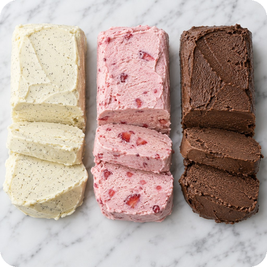<br />
<b>Slice your ice cream</b><br />
Vanilla, strawberry or chocolate, hand-sliced from a block.
</td>
<td width="33%" valign="top">
<br />
<b>Pack it cold</b><br />
Every order goes into insulated foil for delivery across Jakarta.
</td>
</tr>
</table>

### Meet the sandwiches

<div align="center">
</div>


## Build it layer by layer

<div align="center">

</div>

<sub>The loop above steps through six sandwiches, from Rp 14,000 (white bread and vanilla) to Rp 21,000 (wheat bread, chocolate, both toppings).</sub>

The builder stacks a photo of every ingredient you pick and shows the result as you go. **Exploded View** pulls the layers apart, and the signature combos fill a whole sandwich in one click.

<table>
<tr><th width="33%">Bread</th><th width="33%">Ice cream</th><th width="33%">Toppings</th></tr>
<tr>
<td valign="top" align="center"><br /><b>Plain White Bread</b><br />Rp 6,000</td>
<td valign="top" align="center">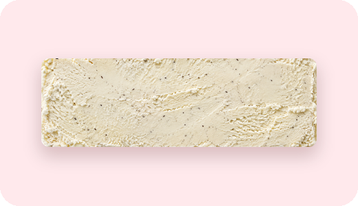<br /><b>Vanilla</b><br />Rp 8,000</td>
<td valign="top" align="center"><br /><b>Chocolate Sauce</b><br />Rp 3,000</td>
</tr>
<tr>
<td valign="top" align="center"><br /><b>Whole Wheat Bread</b><br />Rp 7,000</td>
<td valign="top" align="center">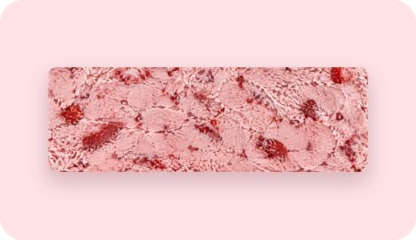<br /><b>Strawberry</b><br />Rp 8,000</td>
<td valign="top" align="center"><br /><b>Rainbow Sprinkles</b><br />Rp 3,000</td>
</tr>
<tr>
<td valign="middle" align="center"><b>24 combinations</b><br />2 breads × 3 flavors × 4 topping choices (none, either one, or both)</td>
<td valign="top" align="center"><br /><b>Chocolate</b><br />Rp 8,000</td>
<td valign="middle" align="center"><b>Rp 14,000 to Rp 21,000</b><br />per sandwich at the seeded prices</td>
</tr>
</table>

A sandwich takes exactly one bread and one ice cream, and each topping at most once.

### Flavor lab

Open a flavor to see what the seeded catalog says about it.

<details>
<summary><b>Vanilla</b></summary>
<br />
<table>
<tr>
<td width="40%" valign="top">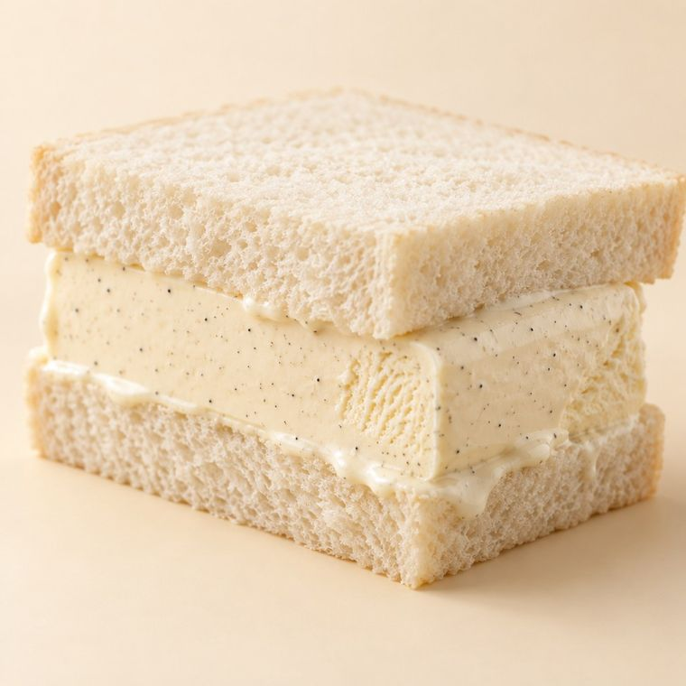</td>
<td valign="top">

Rp 8,000 per sandwich.<br />Seeded with **120** in stock and a reorder point of **40**.<br />The photo shows it on plain white bread.

</td>
</tr>
</table>
</details>

<details>
<summary><b>Strawberry</b></summary>
<br />
<table>
<tr>
<td width="40%" valign="top">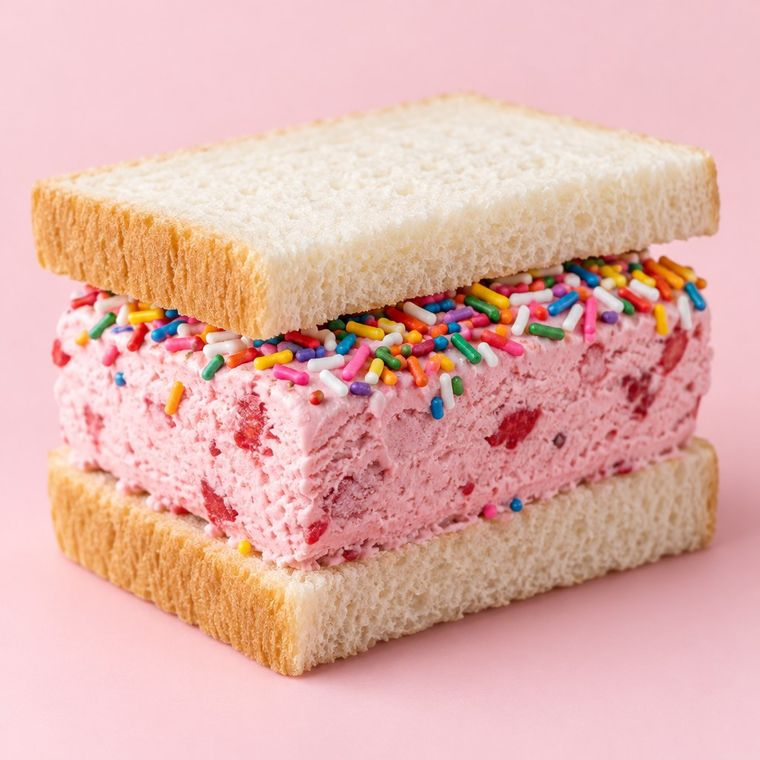</td>
<td valign="top">

Rp 8,000 per sandwich.<br />Seeded with **120** in stock and a reorder point of **40**.<br />The photo adds Rainbow Sprinkles, which are Rp 3,000 more.

</td>
</tr>
</table>
</details>

<details>
<summary><b>Chocolate</b></summary>
<br />
<table>
<tr>
<td width="40%" valign="top"></td>
<td valign="top">

Rp 8,000 per sandwich.<br />Seeded with only **35** in stock against a reorder point of **40**, so a fresh install shows a low-stock alert for it in MRP right away.<br />The photo shows it on whole wheat bread.

</td>
</tr>
</table>
</details>

<details>
<summary><b>Chocolate Sauce</b></summary>
<br />
<table>
<tr>
<td width="40%" valign="top">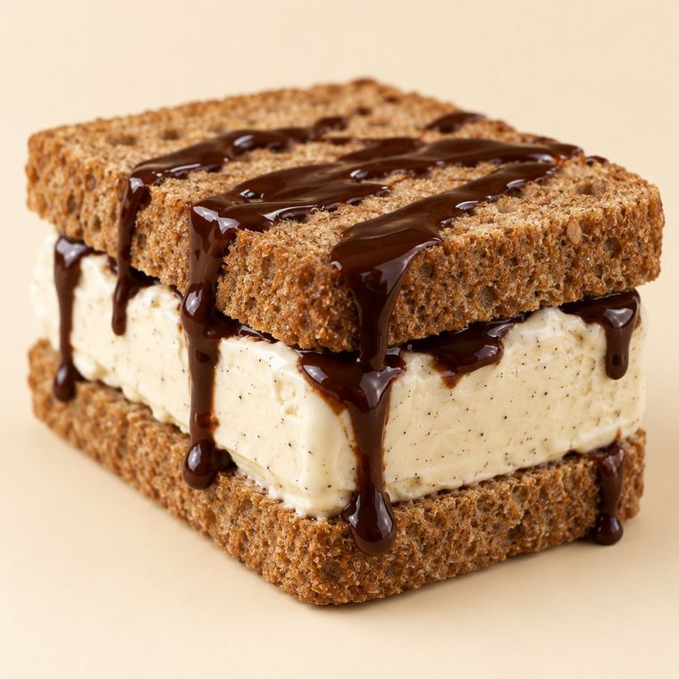</td>
<td valign="top">

A Rp 3,000 topping, seeded with **300** in stock and a reorder point of **60**.<br />Each topping can be added once, and the sauce and the sprinkles can be combined.

</td>
</tr>
</table>
</details>


## Features

### Storefront

<table>
<tr>
<td width="50%" valign="top">
<br />
&nbsp; <b>Brread! Studio</b><br />
Pick a base, a flavor and toppings, and the preview updates live in 3D: drag to turn the sandwich a full 360°, zoom in on the crumb, or open the exploded view to see every layer. Ingredients unlock in order, so you can't build an invalid sandwich. On a phone the 3D preview sits first, with the step bar, signature combos and pickers below it, so a choice shows up without scrolling back.
</td>
<td width="50%" valign="top">
<br />
&nbsp; <b>Cart and checkout</b><br />
The cart survives a page refresh. An order records the customer's name and phone number, and the server charges current prices even if the cart is older.
</td>
</tr>
</table>

Five public pages: home (`/`), the builder (`/builder`), the full menu (`/menu`), the shop's contact details (`/contact`) and a short privacy note (`/privacy`). The privacy note says what checkout collects and why, and the cart drawer links to it right under the name and phone fields. Every page carries its own description plus Open Graph tags, so a shared link shows the `public/img/social-preview.jpg` card in WhatsApp and similar apps. Checkout asks the customer to confirm the name and phone number they typed before the order is placed. The contact page shows the counter at Telkom University Jakarta, Kampus C Minangkabau (Jl. Minangkabau Barat No. 50, Setiabudi) on a live Google Map, with an Open in Google Maps link to the place and a Get directions link, and Instagram (`@brread.official`) replaces the old email address. The map uses the Google Maps Embed API when `GOOGLE_MAPS_API_KEY` is set and falls back to the keyless Google embed when it is empty, so it always shows. Create the key in Google Cloud, enable only the Maps Embed API, and restrict it to the site's domain by HTTP referrer, because an embed key is public by design (see `config/services.php`). A custom `/404` page matches the site's look instead of Laravel's default error screen, and the ingredient images were re-encoded to WebP (about 80% smaller) to keep the builder fast on mobile.

### Order tracking

Once staff confirm an order the customer gets a private status link (`/order/status/<token>`). The page is styled as the paper ticket from an ice cream cart: flat colors, thick chocolate outlines like the logo, hard offset shadows and no blur or glow anywhere.

- **A queue ticket.** The order number is set huge on a perforated ticket, with a scrolling tape above it. A rubber stamp (Terkonfirmasi, Menunggu or Dibatalkan) slams onto the ticket, rings out and shakes it.
- **A stamp card.** Masuk, Dikonfirmasi and Siap Nikmati are three boxes that get stamped one after another. A pending order keeps a dashed box with a ticking hourglass and a ticket-machine counter that flips every second. A cancelled order gets a red stamp, a grey disc and a slumping sandwich over a spreading puddle.
- **A sandwich that builds itself.** The pink stub draws a Singapore style ice cream sandwich in one 3/4 view: a thick slab of ice cream lying flat inside ONE slice of bread folded in half like a book. The spine is on the left, the lower half sits under the slab, the upper half folds over the top and rests closed on it, and the front and the right end stay open so the slab pokes out of the bread. It is drawn in SVG from the order itself (`partials/order-folded-sandwich.blade.php`, styled by the `.fs*` rules in `resources/css/order-status.css`) with every point computed from one projection, so the faces always agree. Both halves share one toasted crust band that runs round the fold, with soft crumb from the cut-out photo of the bread that was picked (white or wheat, which also sets the crust colour); the slab uses the flavour that was picked and only the toppings that were ordered (chocolate sauce, sprinkles) are drawn on its top, front and end. It assembles in three beats: the slice lands flat on the disc, the slab drops onto it, and the top half swings over, then it squashes and throws comic impact lines. An order with several creations gets a tab per creation, the disc tilts with the pointer on desktop, and cancelled orders show it greyed out and slumping into a puddle. **Poke it.** Tapping, clicking or pressing Enter or Space on the sandwich (the stage is keyboard focusable, with a dashed focus ring) runs a ~900ms sequence: it squashes down, the top half flips open like a book lid while the slab bounces up so the texture shows, sprinkles hop or the sauce wobbles (a soft wobble when there are no toppings), the existing impact rays fire, then the lid closes with a squash and settle, plus paper confetti. A tap during the sequence restarts it cleanly, and pointer tilt pauses while it runs. Three quick taps in a row (the count resets after 2 seconds) also pop a comic speech bubble above it with a short Indonesian line picked to fit the order state; only one bubble exists at a time and it fades after about 1.6s. Cancelled orders get the flip but no confetti and no bubble. With reduced motion on, and in the small copy inside the review popup, only the final pose is shown (a poke then gives just a brief highlight, no flip and no confetti; the bubble still appears, without animation).
- **A thermal receipt.** Rincian Belanja prints itself out of a slot when it scrolls into view, with dotted-leader rows per ingredient, a double-ruled total that counts up and a Code 39 barcode of the order number.
- **A printable receipt.** Cetak Struk swaps the page for a one-page A4 receipt in the same monospace style: logo, status stamp, every ingredient with its own price, total, a barcode that scans as Code 39, the rating if the order was reviewed, and the shop's Instagram. The barcode is drawn by `app/Support/Code39.php` as inline SVG, so there is no image library and no network call.
- **A review slip that celebrates.** Each star pick stamps in with comic lines and a mood label. Pressing Kirim Ulasan opens a popup: the card slams down, a big MAKASIH stamp hits it with ripples, the stars stamp in one by one and flat paper confetti shoots from the corners. The form posts in the background and the server answers JSON (200 saved, 422 invalid, 409 already reviewed, 403 cancelled); if the request fails the plain form post runs instead and the popup opens on the next page load. A review is still written once and never replaced.

Every animation uses only `transform` and `opacity` (the confetti is one canvas), and `prefers-reduced-motion` keeps every state but drops the movement and the confetti. The icons inside the ticket, receipt and popup are inline SVG, and their two fonts (Bagel Fat One and Space Mono) are self-hosted through `@fontsource`, so those parts do not depend on Google Fonts. The styles live in `resources/css/order-status.css` and the behavior in `resources/js/order-fx.js`.

### Staff portal

Every module opens with the same header (`resources/views/components/staff/page-header.blade.php`): an icon tile, the page title, a one-line description and, where it helps, a back link or an action button. Confirmations such as cancelling an order or removing an expense use an in-page dialog instead of the browser's own popup.

<table>
<tr>
<td width="50%" valign="top">
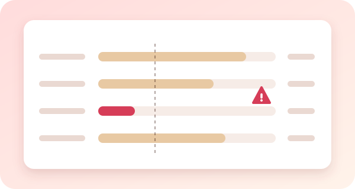<br />
&nbsp; <b>MRP, ingredient stock</b><br />
Stock levels, reorder points and low-stock alerts for every ingredient. Restock or correct a count with a note. A restock cost becomes an expense in Accounting, and every change is kept in a movement history.
</td>
<td width="50%" valign="top">
<br />
&nbsp; <b>HR, people and duty rotation</b><br />
Add, edit and deactivate employees. A fixed rotation puts 3 active employees on duty for 3 days at a time and wraps around the list, so adding or reordering staff reshapes the schedule immediately. The seeded team is Rizky Sandi Pratama (Ketua) and eight members, nine people in all, which makes three duty teams of three. A migration swaps the early placeholder crew for this roster on existing databases and leaves anyone added by hand after them.
</td>
</tr>
<tr>
<td width="50%" valign="top">
<br />
&nbsp; <b>Accounting, cash flow</b><br />
Income arrives from orders, and staff log expenses by category. Choose a date range to see the opening balance, income, expenses and closing balance, then export the report and ledger to Excel.
</td>
<td width="50%" valign="top">
<br />
&nbsp; <b>Sales, what sells</b><br />
Best-selling combinations, rankings for breads, flavors and toppings (including the ones that never sold), trends by day, week or month against the previous period, and the busiest days and hours. Admin only.
</td>
</tr>
<tr>
<td width="50%" valign="top">
<br />
&nbsp; <b>Menu &amp; Prices, what customers can pick</b><br />
Add a new bread, ice cream flavor or topping, edit its name, color and price, hide it from the builder or delete it if nobody ever ordered it. A price change only affects orders placed after it. Admin only.
</td>
<td width="50%" valign="top"></td>
</tr>
</table>


## What happens at checkout

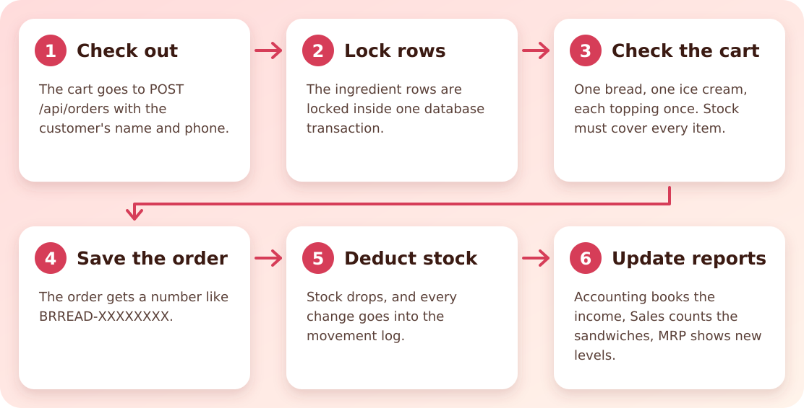

The ingredient rows stay locked for the whole database transaction, so two customers racing for the last unit can't both get it. If an ingredient runs short, the customer sees how many are left. The order endpoint accepts 30 requests per minute per IP address, and the login forms accept 10 attempts per minute per username and IP address.


## Staff manual

### Sign in

| Portal | Address | Accounts |
|---|---|---|
| Staff | `/staff` | `staffmrp` (MRP), `staffhr` (HR), `staffacc` (Accounting) |
| Superadmin | `/superadmin` | `superadmin` |

Staff and admins use separate login pages, and an account only works on its own page. The seeded staff passwords are in [`docs/STAFF_LOGIN_GUIDE.md`](./docs/STAFF_LOGIN_GUIDE.md), and the admin password comes from the maintainer.

On `/superadmin`, a one-click admin login appears only when `APP_ENV=local` **and** the page is opened on `localhost` or `127.0.0.1`. A deployed copy never shows it, whatever the environment says, because anyone who could open the page would become an admin. The password is no longer sent to the browser.

**Superadmin account.** The admin account is named `superadmin`. A migration renames the old `admin` row in place on the first deploy, so its password and history carry over, and `ADMIN_PASSWORD` stays the variable that sets it (`SUPERADMIN_PASSWORD` works too and wins if both exist).

**Passwords in production.** The seeder runs on every deploy. It creates the four accounts if they are missing and leaves existing ones alone, so a changed password survives. To set or rotate them, define one variable per account in the host's variables: `ADMIN_PASSWORD`, `STAFFMRP_PASSWORD`, `STAFFHR_PASSWORD` and `STAFFACC_PASSWORD`; the next deploy applies them. `STAFF_PASSWORD` still works as a shared fallback for any staff account that has no variable of its own. If an account has no password variable in production, new accounts get a random password printed once in the deploy log. The documented defaults only apply to local environments.

**Sign-in check.** Both sign-in forms show a CAPTCHA image: five bent, tilted letters spread well apart, drawn on the server (`app/Support/LoginCaptcha.php`, PHP's GD library and the free DejaVu Sans Bold font in `resources/fonts/`) with a wave distortion and noise lines. The letters are never in the page. Only the image is sent, the answer stays in the session, and the form field is checked before the password, so a wrong answer reveals nothing about the credentials and a script gets no password feedback. The first attempt uses the code up, so a solved image cannot be replayed, and the refresh button next to the image (or a reload) draws a new one. Typing is not case sensitive, and letters that look alike (I, L, O, 0, 1) are never used. It is on by default and `LOGIN_CAPTCHA=false` turns it off for local work; the test suite disables it except in its own tests. It stops simple scripts and works beside the rate limits below, but it is not a replacement for a service such as Cloudflare Turnstile if the site ever faces determined bots, and it has no audio option for screen reader users. The password field has an eye button on its right edge that shows or hides what was typed (it is a real button with a changing "Show password" / "Hide password" label for screen readers). Because the field is pale on the dark page, the button is a pink chip with a dark outline and a dark icon that flips to a dark chip with a white icon while the text is showing, and it turns blood red with the rest of the page in the broken theme.

**Which address is yours.** The app sits behind Railway's proxy, so it reads the visitor's address from forwarded headers, and a visitor can write those too: Laravel would take the first `X-Forwarded-For` entry, which would let anyone pick the address the rate limits, the lockdown, the IP blocks and the security log see. Railway's edge sets `X-Real-IP` to the address it actually saw and overwrites any copy the visitor sends, while it appends its own edge address (a public IP in Singapore) to the end of `X-Forwarded-For`. `TrustOnlyTheProxyHop` uses `X-Real-IP` when it is there and otherwise the right-most public address of the chain, before anything reads the header (`app/Http/Middleware/TrustOnlyTheProxyHop.php`, `tests/Feature/ForwardedAddressTest.php`).

**Which sign-in page after a timeout.** A signed-out visitor who opens any protected page is always sent to the `/staff` form, whoever they were. `/superadmin` is never named by a redirect, a link, an error page or a sign-in message: signing in on `/staff` with the admin's credentials gets the same plain "These credentials do not match our records." as a wrong password. The only place that sends anyone to `/superadmin` is the sign-out of a signed-in admin. The small `portal` cookie from earlier versions is still written but no longer read.

**Wrong password, a terminal talks back.** Someone guessing passwords by hand on `/staff` or `/superadmin` gets a joke that escalates over four misses (`app/Support/LoginPrank.php` on the server, `resources/js/prank.js` in the browser). The text is in Indonesian. Miss 1 and 2 pop up a small terminal next to the form with the "fahh" sound from `public/audio/prank-fahh.mp3`. The terminals of miss 1 and 2 are ice cream sandwiches (the windows over the Kewer video keep the dark lockdown look, see below): the title bar is a toasted slice of bread with air holes and sprinkles for window buttons, the text sits in strawberry cream with sprinkles scattered over it, and a second slice of bread closes it below. It can be dragged anywhere by either slice (mouse, pen or touch), and every letter it types is a hacker keyboard clack (synthesized, with a digital blip now and then). Miss 1 (`brread@counter`) says "Pencet sekali lagi wak kalo hoki kamu dapet ayam bakar". Miss 2 (`cari_ayam`) shows a progress bar, says "yahh ayam nya kabur.. coba tebak lagi deh passwordnya kali aja bener" and suggests "coba admin12345678 dehh". Both windows stay on screen (only their x closes them) until miss 3 takes over. Miss 3 is not a window: the screen drops into a red trace with scanlines and static over a low beating drone, a crosshair hunts around under a rising swell and a stream of data blips, locks on ("target terkunci") with the recorded impact from `public/audio/lockdown-hit.mp3` and a heartbeat, the caller's real IP decodes digit by digit in the lockdown's split-colour Impact, their city and country slam in below in its dark blood-red serif that keeps glitching, and a message types out key by key with a keyboard click for every letter over a dial-up style burst and breathy noise: "yey selamat kita dapet IP kamu, ternyata kamu orang <city>...", ending on a low siren. There is no "fahh" here, the sound is all hacker horror and every sound except the impact is synthesized. After the trace the whole sign-in page shifts to a broken red theme for the last try, while every field and the button still work: the ice cream drip at the top is gone, the sprinkle wallpaper becomes a red grid that jumps and pulses under a dark vignette, the logo, labels, fields and button turn blood red, the header is warped by a moving displacement filter and tears sideways, the card is tilted, gently warped and split into dark and bright red edges, a red ghost copy of it jumps around in torn bands, the whole page flickers and slips, labels, title and button text keep re-corrupting into stacked glitch marks or junk characters, dead pixels and broken blocks pop up across the screen, and a rolling scanline layer covers it all. A reload keeps it broken, because the server remembers the three misses. A glitchy horror bed plays under the broken form (a detuned sub drone, a thin whine and random stuttering static, bit-crushed blips, dropouts and thuds, all synthesized; after a reload it starts on the first click or key press) and stops when miss 4 begins. Getting the password right on that last try plays the victory fanfare in `public/audio/prank-fanfare.mp3`, winds the glitch down over about two seconds, then a sheet of melting strawberry (the same one that wipes the shop's entry intro) drips down over the screen and moves on, leaving a cream Brread "ACCESS GRANTED" screen: the sandwich from the intro drops together piece by piece, sprinkles burst out of it, the letters bounce in, it greets the user by name and a strawberry loading bar fills. A second strawberry sheet then melts down over it and the browser goes on to the menu, where the lockdown guard lays the same pink over the first frame and lets it melt on down, so the whole way from the broken form to the menu has no hard cut. A normal sign-in on a page that never broke skips all of this. Miss 4 is the punishment, and it is not a small window: the whole screen is taken over by a black console under a heavy impact, static, a drone, key clicks, data chirps and a dial-up burst. It types out what the page can tell about them (their IP, place, network provider, system, browser, screen size and time zone), "copies" their login history with a progress bar, "sends a report to the admin", then slams "KAMU YANG MINTA." with a siren and a rising swell, shows the lock time for their IP and counts 3, 2, 1 over heartbeats, with a vignette that closes in all the way. Everything is dark red on black and nothing flashes bright. Then it cuts to the Kewer Kewer video (`public/video/prank-kewer.mp4`) on a loop with sound, in the same red theme, with a "sign-in locked" countdown on top. Sign-in is paused for that address on the server: 1 minute the first time, 3 the second, then 5 minutes at most, and even the right password is refused until the time is up. A reload during the pause comes straight back to the red page and the video (silent until the first click, since browsers block sound without one), and it counts as an escape attempt too: typing another address, the browser's reload button and its Back button each get their own terminal and noise when the page comes back, and a correct sign-in clears the count. While the pause lasts there is no way out of that view: the video has no close button, only "Back to Brread!", and that button, every link on the page, the browser Back button (the history is padded with extra entries), Alt+Left, F5, Ctrl+R and the right-click menu are all refused. Each try opens an `escape.sh` terminal that makes fun of it with a noise meant to be unbearable that gets worse every time (a game show buzzer, an error ding and a stuttering "fahh" at random pitch from either side of the head, then a clown horn, Sans laughing, and finally a slammed boom with a siren), the video tears in dark colours, the screen shakes harder every time, and a crowd of small windows ("no_escape.exe", "ayam_bakar.exe", "kapok.sh") appears on top, up to 16 at once, where closing one opens two more; every fourth try slams "KAPOK?" over the video with a siren. Even if nobody tries to leave, something creepy fades over the video every 7 to 13 seconds ("kami lihat kamu.", "<city> ga jauh kok.", "kapok belom?") with a random nuisance sound. A Windows 11 notification in dark theme (a shield, "Windows Security", "Turn on virus protection", "Virus protection is turned off. Tap or click to turn on Microsoft Defender Antivirus." and a Dismiss button) slides in at the bottom right about 6 seconds into the video with the Windows notification sound from `public/audio/prank-winnotify.mp3`, and again every half minute or so. Nothing on it closes it (the x, the three dots, the button and the text only make it wobble), it leaves by itself after exactly 15 seconds. The page also asks the browser for fullscreen on every click and key press (a browser only allows that inside one, and holding Esc leaves fullscreen but the next click goes back in; Esc itself is claimed with the keyboard lock where the browser supports it). Six tries to leave within 15 seconds (Back to Brread!, the browser Back button, F5, Ctrl+R, links) bring a Windows blue screen over everything for 10 seconds: the first 10 seconds of `public/video/prank-bsod.mp4`, with the Windows XP critical error sound from `public/audio/prank-xperror.mp3`, no cursor, the keyboard blocked and the Kewer music stopped dead (nothing restarts it, not even the keep-it-playing timer). Then the blue screen cracks from one point like glass under a huge "PRENGGG!" with a synthesized glass-breaking sound and falls away in triangular shards, while the Kewer video starts again from zero behind them. The windows and terminals are gone, "lagian lu iseng sih nambah kan waktunya" slams over the video, and the pause is set to at least 2 minutes from that moment (a longer remaining pause is kept). The browser remembers that longer pause, so even after the server's own pause is over a reload goes back to the video until the clock runs out. The sound effects wake the browser's audio again on every key press and click, so they keep playing after a reload. A website cannot block the browser's own reload button, closing the tab, or another browser, so those are the limits: reloading just lands on the same paused page and video again (there is no "Leave site?" prompt to click through), and the video's sound is kept on, since a mute or volume change on the video is undone and the media keys cannot pause it (the browser's own tab mute and the system volume are out of a website's reach). The pause also follows the browser around the shop: it is remembered in the browser's storage, so typing `/` or any other address, in this tab or a new one, sends it straight back to the sign-in page that set it off, and a page that opens with no pause on the server forgets it (unless a blue screen made the browser's pause longer than the server's). The two ways out are closing the tab or sitting through the video until the countdown ends, when the trap lets go and the page goes back to normal. Misses are remembered for 30 minutes and pauses for a day, per address. A wrong captcha does not count. Scripts that keep hammering during the pause still run into the rate limits and the lockdown screen below. `LOGIN_PRANK=false` turns it off, and `prefers-reduced-motion` gets the same text without the pops, the flicker, the shaking and the growing.

**A right password gets a quick welcome.** A correct sign-in on a page that never broke (`/staff` and `/superadmin` share the `staffLogin` component) plays a short version of the cream "ACCESS GRANTED" screen before the redirect: title letters, "welcome back, <username>", a loading bar and two status lines, about 1.9 seconds in all (`quickSuccess()` in `resources/js/prank.js`). It has no melting sheets and no sound, and nothing waits for audio. The browser is sent on when the scene ends or after a hard 3 second cap, whichever comes first, never twice; the destination is prefetched meanwhile, the Sign in button stays disabled, and if `prank.js` fails to load it is a plain redirect. With reduced motion it is the same text fading in for about 0.6 seconds. The one-click quick login for the admin is a plain form post and keeps its direct redirect. Both versions of the scene (this one and the long one after four tries) now draw the same sandwich as the order status page: one slice of bread folded round a flat slab of ice cream, cloned from a `<template id="granted-sandwich">` that the sign-in page renders from `partials/order-folded-sandwich.blade.php`, and it builds itself during the scene.

**Arrow keys on the sign-in form.** ArrowDown and ArrowUp move between username, password, the captcha box, "Keep me signed in", Sign in and the back link (the eye and refresh buttons count as part of their neighbours). ArrowLeft and ArrowRight stay caret keys inside the text boxes and, on buttons, the checkbox and the link, step to the previous or next control. Tab and Shift+Tab are untouched, and nothing happens while the form is locked, busy, or taken over by the lockdown or a prank scene, or when a modifier key is held. When focus moves (arrows, Tab or a click) one pink ring slides from the old control to the new one in about 220ms with a small scale nudge on the new box, then hands over to the normal focus ring; with reduced motion focus just moves. The listener is delegated on the page root and removed when the component is destroyed (`setupKeyboard()` in `resources/js/app.js`).

**Lockdown screen.** When someone hammers the sign-in forms, the form glitches (RGB split, sliced screen, scanlines) with a synthesized static burst, then their screen is taken over for about five seconds: red code pours down behind an "UNAUTHORIZED ACCESS" panel that types out a trace of their address, place, network, browser and the username they tried, "WE HAVE YOU." slams in with the recorded impact from `public/audio/lockdown-hit.mp3`, and the screen switches off like an old monitor to reveal the locked page. All of it is in English. The header "behind the counter / Superadmin" becomes "welcome," followed by the username they typed (cut at 22 characters, and kept with the lock so a reload still greets them by it), with their browser, system and approximate place underneath. Browsers never reveal the computer's account name or the Chrome profile name to a website, so the typed username is the closest thing; with none typed the page falls back to their system ("Windows user"). The card shows a banner that keeps changing ("TOO MANY ATTEMPTS. WE KNOW. SIGN-IN HALTED.", "WE SEE YOU, <name>.", "IT'S RIGHT BEHIND YOU."), disabled fields and "SYSTEM LOCKED" with a countdown, while the page around it plays the music from `public/audio/lockdown.mp3` with no way to mute it, adds a heartbeat that speeds up over time, closes in with darkness that tightens on every beat, fills slowly with blood from the bottom, keeps blood dripping from the top, opens red eyes in the dark that follow the cursor, slams bloody hand prints onto the screen, spells huge words letter by letter behind the card ("I CAN SEE YOU", "<city> IS NOT FAR", "THERE IS NO WAY OUT") with a breath in one ear, rots the form labels into corrupted text for a moment, rolls a VHS tracking band down the screen, cycles the tab title ("I SEE YOU", their IP, "DON'T LEAVE") and shows a tall figure that steps closer every few seconds. With no warning and no build-up, while the music is still playing, its face slams into the glass on top of everything: at a random moment after the figure gets close, at random times on its own (the first one 14 to 30 seconds in, then every 28 to 75 seconds), and now and then when a pop-up window is closed. It covers everything, pop-up windows included, twitching in red and cyan with white and red strobe frames, a rising swell, the recorded impact and a distorted, many-voiced shriek while the music drops away. When the face is gone every open pop-up window tumbles off the bottom of the screen, and three seconds later they all pour back in. A red glow and small shakes follow the low end of the music through the Web Audio analyser. It also reacts: a click leaves a blood splatter, a key press crackles and the banner says "STOP TYPING.", moving the mouse toward the tab bar brings hands and "WHERE ARE YOU GOING?", switching away and back brings "YOU CAME BACK." and the face, the page goes full screen when the browser allows it and, in Chrome, locks the Esc key so a tap does nothing and it has to be held down (the browser's own "To exit full screen" notice cannot be hidden by any website), leaving full screen counts as an escape attempt and the next click puts it back, right-click is refused, docked developer tools bring "CLOSE THE CONSOLE.", the volume-down and mute keys bring "TURNING US DOWN WON'T HELP" on keyboards that pass them to the browser (the volume slider and a muted tab cannot be seen by any website), every way out counts as an escape attempt and opens a crowd of pop-up windows ("no_escape.exe", "YOU CAN'T GO BACK.", "escape attempt 3 of 10") whose OK, Cancel and close buttons each open two more: Back, F5 and Ctrl+R (swallowed), the browser's reload button and a Back that slips past the history trap. The lock is kept in the browser's storage too, so a reload, or opening any page of the shop in any tab, lands straight back on the locked page with the attempt counted, and the eleventh attempt finally lets go onto a 404 page, and the "Back to Brread!" link is greyed out and unclickable. Red system log lines type down both sides with the caller's real IP, browser and username, and one keeps counting how long they have been watched, and a toast says "Your IP address has been recorded. Do not try again." When the countdown ends the page reloads as the normal form. Nothing flashes bright: every flicker is dark on dark and slower than three a second, and the face is a dark shape. Two things trigger it (and both lock the address in the cache, so a reload stays locked): hitting any of the sign-in rate limits, and a username that carries an attack payload (quotes, `--`, `<script>`, `../`, `union select`, or more than 100 characters). A payload locks that address out of both sign-in pages for ten minutes through the cache, even with correct credentials, and every trigger writes a `security.lockdown` warning with the IP, path and user agent to the log, so the "recorded" line is true (`app/Support/Lockdown.php`, `app/Http/Middleware/LoginLockdown.php`). Ordinary typos and wrong passwords never trigger it, they only show an inline error. The form posts through `fetch` so the page stays open and the browser allows the sound; a page that opens already locked starts the sound on the first click or key press. With scripts off it still works as a normal form and the server answers with the same page already locked. The effects load on demand from `resources/js/lockdown.js` and every sound except the music is synthesized with the Web Audio API. With `prefers-reduced-motion` the page shows a still version with the music and without the glitch, the shakes, the hands and the face. A background photo can be added at `public/img/lockdown-bg.jpg`. To watch it without locking anyone out, sign in as the superadmin and open the unlisted address `/x7f-q9z/0x2e-lck_n0/dXJ0` (change it with `LOCKDOWN_PREVIEW_PATH`); the first click plays everything, and nothing is locked or logged. The preview's trap only lives in that browser tab, so close the tab to get out early. The address is linked from nowhere and answers 404 to guests and staff, so it gives nothing away. This is a deterrent and a bit of theatre, the real protection stays the rate limits, the captcha and the headers.

**Admin honeypot.** The superadmin sign-in exists only at `/superadmin` (GET and POST); `/admin` no longer redirects there. A guest who goes looking for an admin panel at `/admin`, `/administrator`, `/wp-admin`, `/login`, `/dashboard`, `/panel`, `/cpanel`, `/phpmyadmin` or `/backend` (and any sub-path of them) is held for 60 seconds in two phases: a cinematic camera feed of 30 seconds (`HORROR_SECONDS`, default 30), then the Kewer scene for 30 seconds (`KEWER_SECONDS`, default 30). The code is `app/Support/HoneypotTrap.php`, `app/Http/Controllers/HoneypotController.php`, `app/Http/Middleware/TrapHoneypotVisitors.php`, `resources/views/honeypot/trap.blade.php`, `resources/js/honeypot.js` and `resources/css/honeypot.css`. The server is the clock: it stores the start time per IP address in the cache (its own keys, apart from the 1, 3 and 5 minute wrong-password ladder) and hands the page the elapsed seconds, so a refresh, a new tab, another address of the shop or coming back later resumes on the same master timeline (still in the camera feed before second 30, straight into Kewer after it) and never restarts or replays phase A. While the hold runs, every page of the shop and every unknown address redirects a guest to the trap, and only the trap page and its media load, with no link back. Signed-in users are never held. When the 60 seconds are over the hold is cleared and the browser goes to Home, not to `/superadmin`; the address is then left alone for two more minutes so Back cannot restart it. The hit is logged like the lockdown (a `security.lockdown` warning and a `security_events` row with the reason "Admin honeypot", merged within a minute); a hold starts once per address per window, which is also the throttle against abuse. `HONEYPOT_TRAP=false` turns the trap off (the addresses then answer 404; the test suite switches it off). None of these addresses is a `Route::redirect` (a cached 301 would send a visitor away without ever reaching the trap), every honeypot answer, including the 303 that sends a held visitor back, carries `Cache-Control: no-store`, and `HoneypotTrap::PATHS` is the single list the routes and the middleware share. For repeated testing, `?replay=1` on a trap address ignores the two minute grace period and starts a fresh hold; it works only when `APP_ENV` is not `production`, and is ignored there.

Phase A is one continuous 30 second shot on a night security camera, "BRREAD! COLD ROOM 03 / CAM 3", built from real art plates in `public/img/honeypot/` (about 1.9 MB in total, optimized WebP plus one 640 KB cue track, well under the 6 MB budget): `room-closed`, `room-open`, `light-spill`, `fog`, `foreground-pipes`, `sandwich-hero`, `character-fullbody` (the cutout of the owner), `aim-pose`, `muzzle-flash` and `glass-crack`. The beats: black and a camera boot with static, REC, a real local time stamp and one buzz (0 to 2.5 s); the closed, near-black room with a weak teal bulb, the sandwich with a thin cold rim, a drip, then one heavy thud behind the door and a thin red line flickering around the frame (2.5 to 7 s); the door creaks open, red light floods in through haze and god rays, the owner appears in the doorway as a hard silhouette and the HUD flips to "INTRUDER DETECTED" (7 to 10 s); a slow dolly-in while he walks in two strides of three weighted steps, each stride easing in and out on a cubic, one full stop in total silence around 13 s with a subtle head turn, a 250 ms settle at each mark and the cloak overshooting a little as he stops (9.5 to 16 s); the first dialogue card alone, `Mana Mungkin Seorang "Vassell Enha"` with the name in brand pink (16 to 19 s); a short silence with a drip and a slow push-in with a focus pull; the second card `Memberikan Akses Panel Admin ke Amatiran Seperti Anda.` typed in and held, with one very low stinger on the last word (19.8 to 24 s); a 400 ms crossfade to the aim plate with a push-in from 1 to 1.12 and a rack focus, the red light in his eyes igniting 150 ms before the face is fully there and the key light ramping up over about a second, no flash (24 to 25.7 s); the pistol rising from below the frame over 500 ms with a small overshoot (25.7 to 26.2 s); a 400 ms hold in total silence (26.2 to 26.6 s); the shot, one local muzzle flash on the bore for 2 to 3 frames, a hard gunshot with a long reverb tail that ducks every other sound for 300 ms, and a recoil of the camera and plate of 10 px that springs back (26.6 s); the camera dies: the glass cracks 60 ms after the shot, growing out of the muzzle point in 180 ms, sparks and a zap, the picture slips with an RGB split, rolls and freezes, the HUD and time stamp stutter out, "CAM 3  NO SIGNAL" flickers, then a CRT power-off (a bright line, then a dot, with a falling whine) and a dim "DISCONNECTED" in Space Mono (26.6 to 29.3 s); half a second of black and one low thud, then a hard cut into phase B. The pistol only ever points at the lens, there is no blood, and the owner is called only "Vassell Enha" or "the owner". His photo is used as given: lighting only hides or reveals the face and nothing is retouched or generated.

How it is built: one `requestAnimationFrame` loop with a delta clock drives every layer, the camera, the HUD, the one-shot sounds and the cue track, and every frame is a pure function of that clock, so a seek (refresh, new tab) renders the exact state. The plates are laid out as 3:2 sheets with "cover" geometry, in three parallax groups (far wall, mid with the sandwich and the owner, near pipes) on one slow eased dolly (two overlapping eases, so it never stops) with handheld drift made of three sines per axis at frequencies that never line up, four to six frames of micro-shake on the heavy steps, and a quantized depth-of-field blur. Every move is built from three curves, `outCubic`, `inOut` (in-out cubic) and a small `outBack`, plus a damped spring for the recoil; the smooth step is used only for light and opacity. The owner is drawn on a canvas and moved by one gait. When the optional walk sheet `public/img/honeypot/walk-sheet/walk-1.webp` to `walk-4.webp` (four poses of one cycle on a red background: left contact, passing, right contact, passing) is present, its frames are keyed to alpha once, in slices of about 6 ms per animation frame (the key colour is read from the corners, flat key pixels go anywhere, softer pixels go only where they touch the background and have their red mixed out, so a red rim light inside the body stays), normalized from their own alpha box to one height with the sole on the bottom row and the torso on the centre line, and cached as a dark and a lit canvas per frame (three frames in lighter mode). The step phase picks the pose (two poses per step), neighbours crossfade over about 100 ms as a premultiplied blend, his forward speed ripples with the phase (quicker at heel contact, slower through the passing pose, zero net per step), only the lower 58 percent is cut into strips for the cloak hem, and the floor shadow and wet reflection are redrawn from the pose on screen. If a frame is missing, fails to key or `prefers-reduced-motion` is on, the single standing cutout `character-fullbody.webp` is used as before, drawn as 16 horizontal strips (9 in lighter mode, 8 if the phone starts to drop frames). Both are moved by one gait: a stride is a run of steps, each step is one phase from 0 to 1 between two heel strikes, and that phase drives the vertical bob (two peaks per two steps), a shoulder roll of 1.2 degrees about the hips, a weight shift of 6 px and a small scale rise at each heel strike, all scaled by his speed; the strips follow his weight shift 120 to 180 ms late, the hem the latest; his floor shadow is a skewed, stretched, blurred copy of the silhouette and the wet reflection a flipped, faded copy, driven by the same position value as the body. Plates load in order of need with `img.decode()`; the black boot shows immediately, and the visual clock waits for the plates the next moment needs, then catches up slightly faster than real time (a resume only loads what the current moment needs). The aim plate is composed for the screen: a portrait phone shows it natively, a landscape screen shows about 70 percent of its height at under 1x scale with the dark red sides extended by a mask, and the upscale is capped at 1.5x. Typography is Bagel Fat One for the dialogue and Space Mono for the HUD, loaded on this page only and checked with `FontFace` status before the text is read, with a fallback stack of Baloo 2 and system fonts. The aim plate pistol is baked into the plate, so it rises from a masked copy of the plate over a patch made from the mirrored plate (the other cheek and shoulder). Sound is one-shot effects with real silence in between, no loop and no drone, scheduled on the audio clock from the master timeline (a reload at second N resumes without replaying old sounds). Every voice has at least two layers and runs through its own gain (plus or minus 1.5 dB), random pitch (plus or minus 4 percent), a low-pass that closes with distance, a stereo pan (the footsteps follow him from left to right) and a 15 to 35 percent send to a procedurally generated cold-room reverb (1.8 s of decaying noise, 2.8 s for the shot), then one master gain and a compressor (threshold -18 dB, ratio 4:1, attack 5 ms, release 180 ms). The gunshot bypasses the duck, the glass follows it by 60 ms, and the power-off is a falling whine and a small pop. Real recordings are optional: put any of `door-creak`, `footstep-wet`, `drip`, `heavy-thud`, `cape-rustle`, `fluorescent-buzz`, `gunshot`, `glass-crack`, `zap`, `crt-off` or `stinger` (mp3, ogg, wav or m4a) in `public/audio/honeypot/`; the server lists the files that exist, the browser loads them with `fetch` and `decodeAudioData`, and a missing or broken file keeps the synthesized layers. The Suno cue `public/audio/honeypot-cue.mp3` (29.8 s) is fetched and decoded once and played once through the same master bus (compressor and a small reverb send) from an `AudioBufferSourceNode`, so it is sample accurate with the timeline and a reload at second N starts it at the matching second of the file. The file is placed, not stretched: its loudest bar (second 25.0) sits on the start of the face reveal (24.0 s), so it starts 1.0 s into the file and a `stop()` scheduled on the audio clock cuts it hard at the shot (26.6 s). Its gain is silent until the door opens, swells in as he appears, is strongest on the approach, climbs to its climax from the reveal at 0.55 before the bus, ducks only 4 dB under dialogue and effects, has one 300 ms gap right before the shot and nothing after it; if the decode fails, a plain `Audio` element plays the same file with the same envelope. Sound starts on load where the browser allows it. Where it does not, a dark CCTV card ("SINYAL TERTAHAN / KETUK UNTUK MELANJUTKAN") appears over the feed and any tap or key starts the sound and removes it; the timeline never waits for it and the card says nothing about leaving. There is no mute control.

Accessibility and safety: nothing flashes faster than three times a second and every flicker in the cold room is dark on dark; the door light and the face key light are gradual ramps. The muzzle flash is the only intentionally bright moment: it happens once, stays local to the face and the haze, and decays in 2 to 3 frames. With `prefers-reduced-motion` the trap, the shot, the text and the cut to Kewer stay, but the walk becomes a fade-in and the camera drift, shake, recoil, the pistol rise, the rack focus, tears and flicker are dropped, the flash becomes a soft 200 ms glow and the fades are slow. A lighter mode (4 cores or fewer, or under 640 px wide) uses fewer strips, no focus blur and fewer particles, and a phone that averages below about 42 fps for a few seconds is switched to it on the fly, along with a plain blend for the cracked lens.

Phase B is the Kewer scene: the video full screen with sound locked on (no controls, and a mute or volume change is undone), glitch layers, scanlines, grain, floating terminal windows, stamped taunts, the line returning as a short caption, and a counter that shows only the seconds left. In both phases there is no way out offered and no "Leave site?" dialog (no `beforeunload` handler exists anywhere): the page asks for fullscreen on every press and claims Esc with the keyboard lock where supported, right click and every key are refused, the history is padded so Back stays on the trap, and each escape attempt answers with a small pop-up; six within 15 seconds bring the blue screen from `public/video/prank-bsod.mp4`, which never outlasts the hold. Limits: Firefox and Safari have no Esc keyboard lock (Esc leaves fullscreen there and the next press puts it back), no browser lets a website stop closing the tab, Back, the address bar, Ctrl+W or Alt+F4; the server hold is what makes leaving pointless, because every address of the shop leads back to the trap until the 60 seconds end. The pose of the owner in the doorway is a cutout, so on a very large screen it can look soft; grain hides most of it. The older `public/img/honeypot/vassell-enha.webp` is no longer used by the page.

**Security records.** Every lockdown trigger is saved to the `security_events` table with the IP address, the browser, operating system and kind of device read from the User-Agent (`app/Support/UserAgent.php`, which also names attack tools such as sqlmap, curl or python-requests), an approximate country, city and network provider for the address (`app/Support/GeoIp.php`, using ip-api.com, cached for a day per address), the path and the username that was typed. A flood from one address within a minute stays one row with a hit counter. The superadmin sees them under **Security** in the sidebar (`/staff/security`), with weekly totals, the top country and a filter by reason; no staff role can open it. The locked screen shows the caller the same trace in its log lines and toast. Location is city level at best and names the VPN, proxy or Tor exit when one is used; precise GPS location is not collected, because a browser only gives it with the visitor's explicit permission. The records exist to protect the site and, if needed, to back a report to the police cyber unit or BSSN, who can ask the network provider who held an address at a given time. They are deleted after `SECURITY_EVENT_DAYS` days (default 90) and the Privacy page says so. `GEOIP_ENABLED=false` turns the place lookup off, and private or local addresses are never looked up.

**Blocking an address.** The superadmin can shut any address out of the whole site from the **Security** page: the Block button on a row (or the form at the top, which takes any address and an optional note) adds it to the `ip_blocks` table, and from then on every page answers that address with a dark 403 page ("YOU ARE NOT WELCOME HERE.") until it is unblocked there. The page counts how many times a blocked address was turned away and when it last tried. The delete button on a row removes every lockdown record for that address from the list; a block on it stays until lifted. The check runs on every request through `app/Http/Middleware/BlockBannedAddresses.php` against a cached list, so it costs one cache read, and the health check at `/up` is never blocked. You cannot block the address you are using, and if you ever lock yourself out anyway, `php artisan security:unblock <ip>` (for example from the Railway shell) lifts it.

**Keeping dependencies current.** Dependabot (`.github/dependabot.yml`) opens a grouped pull request every week for Composer and npm packages and every month for GitHub Actions, and the `audit` job in CI runs `composer audit` and `npm audit` so a package with a published security advisory turns the build red. Outdated software is how most sites get breached, so merge those pull requests once the tests pass.

**Staff security habits.** Use your own account and never share it, keep the password unique to Brread!, sign out on any shared or public device (turn off "Keep me signed in" there), and tell the admin right away if a password was seen by someone else so it can be rotated through `ADMIN_PASSWORD` or the matching `STAFF*_PASSWORD` variable.

**Speed on a remote database.** Every page makes about 5 to 13 queries, plus session reads and writes, and each request opens its own database connection. When the app and the database sit in different regions, that adds up to seconds. Keep both in the same region (Railway Singapore with a Supabase project in Singapore). Setting `DB_PERSISTENT=true` reuses the Postgres connection between requests, and `SESSION_DRIVER=file` / `CACHE_STORE=file` keep session and cache reads off the database (sessions then end on every redeploy).

**Hardening in place.** Every response carries `X-Frame-Options`, `X-Content-Type-Options`, `Referrer-Policy`, `Permissions-Policy`, HSTS over HTTPS and a Content-Security-Policy (`app/Http/Middleware/SecurityHeaders.php`) that allows framing only Google Maps (for the contact page map) and nothing else. Sign-in is rate limited, order input is validated on the server and prices are always recalculated there, and all user text is escaped on output. On Supabase, a migration turns row level security on for every table so the public API key cannot read the database; the app itself connects as the owner and is unaffected. Sign-in is throttled per account+address (10 a minute), per address (30 a minute), and per account alone regardless of address (20 every 10 minutes), so spreading login attempts across many IPs does not avoid the limit. The `X-Powered-By` header is stripped, and an order review can be written once and not replaced. A black-box pentest (November 2026: exposed files, headers, CORS, login abuse including a distributed/multi-IP brute-force check, SQL injection, XSS, CSRF, role access, price tampering, malformed order payloads, review abuse) is covered by `tests/Feature/PentestRegressionTest.php`, plus a live test against the deployed site that confirmed no SQL injection or auth bypass.

**Container hardening.** The production image (`Dockerfile`) runs nginx + php-fpm under supervisor instead of `php artisan serve`, which is Laravel's own development server and not meant to take production traffic. Every HTTP request is handled by an nginx and php-fpm worker running as the unprivileged `www-data` user (set by `chown` in the Dockerfile and php-fpm's own pool default), while the master processes still start as root only to bind the port and supervise their workers, so a bug in request handling never runs with root privileges. The Postgres connection also now defaults to `DB_SSLMODE=require` (`config/database.php`) instead of `prefer`, which would otherwise silently fall back to an unencrypted connection to Supabase if the TLS handshake had any trouble.

### What each role can open

| | &nbsp; MRP | &nbsp; HR | &nbsp; Accounting | &nbsp; Sales | &nbsp; Menu |
|---|:---:|:---:|:---:|:---:|:---:|
| &nbsp; **Admin** |  |  |  |  |  |
| **MRP staff** |  | | | |  |
| **HR staff** | |  | | |  |
| **Accounting staff** | | |  | |  |

The sidebar lists only the modules your role can open, and the URL of any other module returns a 403.

### Modules

<details>
<summary><b>MRP</b>: ingredient stock at <code>/staff/mrp</code></summary>

<br />

- The dashboard shows each ingredient's stock level, category, reorder point and status.
- A low-stock alert appears when an ingredient reaches its minimum.
- To restock or correct a count, adjust the stock and write a note. If you enter a restock cost, it is booked as an expense in Accounting.
- The full history of stock movements is at `/staff/mrp/movements`.
- Customer orders deduct stock automatically at checkout, so you never subtract those by hand.

</details>

<details>
<summary><b>HR</b>: employees and duty rotation at <code>/staff/hr</code></summary>

<br />

- Add, edit and deactivate employees from the directory.
- The duty rotation puts 3 active employees on shift for 3 days at a time. It follows the rotation order, so deactivating or reordering someone changes the schedule right away.

</details>

<details>
<summary><b>Accounting</b>: cash flow at <code>/staff/accounting</code></summary>

<br />

- Customer orders appear as money in, and the expenses you log appear as money out.
- To log an expense, pick a category: Ingredients, Utilities, Salaries, Equipment, Rent or Other. You can delete an expense you entered by mistake.
- Choose a date range to see the opening balance, income, expenses, closing balance and expenses by category.
- Export the report and ledger to an `.xlsx` file.

</details>

<details>
<summary><b>Sales</b>: what sells at <code>/staff/sales</code> (admin only)</summary>

<br />

- Best-selling combinations of flavor, bread and topping.
- Rankings for flavors, breads and toppings, including the ones that haven't sold yet.
- Sandwiches sold and revenue per day, week or month, compared with the previous period.
- The busiest days and hours.

</details>

<details>
<summary><b>Menu &amp; Prices</b>: breads, flavors and toppings at <code>/staff/menu</code> (admin only)</summary>

<br />

- Three lists, one per kind: Bread, Ice cream and Topping. Each row shows its price, stock and whether it is on the menu.
- **Add Item** creates a bread, an ice cream flavor or a topping. A flavor also needs a color, which tints its layer in the Studio's 3D preview. You can enter a starting stock, which is booked as a restock in the movement history. Without stock the builder shows the new item as Sold Out until you restock it here or in MRP.
- Change a price straight from its row. The message tells you the old and the new price. Orders already placed keep the price they were sold at, so the books and the sales report never shift.
- **Edit** changes the name, price and color. The kind cannot change, and a name can only be used once per kind.
- **Hide** takes an item off the menu and out of the builder without losing anything, and **Show** brings it back.
- **Delete** only appears for an item nobody has ever ordered. Anything that appears in an order can only be hidden, so sales history stays whole.
- New items show a generic bread or ice cream photo in the storefront. The signature creations and the toppings' pictures in the 3D preview are built from the original ingredient names, so hiding or renaming one of those makes the signature that uses it unavailable.
- The deploy seeder no longer overwrites this data. It only inserts the original seven ingredients when they are missing, so prices, names, hidden items and new items you set here survive every deploy.

</details>


## Tech stack

<b>Backend</b><br />
   

<b>Frontend</b><br />
    

The 3D sandwich runs on <b>three.js</b>, loaded as its own chunk only where it is shown: the home hero (three ready-made combos to flip through) and the Studio on `/builder`. Browsers without WebGL, or with data saver on, fall back to a photo. Any element with a `data-tip` attribute gets a tooltip on hover and keyboard focus (`initTooltips()` in `resources/js/app.js`). The storefront's handmade layer is plain CSS and SVG in `resources/css/app.css`: a drifting sprinkle wallpaper (`.doodle`), melting section edges (`partials/drip.blade.php`), taped polaroids for customer photos, and a two-second entry intro that plays once per browser session and is skipped under `prefers-reduced-motion`. Clicking the logo or the Home link in the navbar (desktop and mobile menu) from another page plays a short, about one second version of the same intro before Home: `app.js` stores a timestamp flag (`brreadHomeNav`, only for plain left clicks, never when already on Home) and the inline script in `layouts/app.blade.php` reads it before first paint and adds `html.quick-intro`, which shortens the timings of the same keyframes (`html.quick-intro #brread-intro` rules in `app.css`). It never plays together with the full intro, it is skipped under reduced motion, it is CSS driven (hidden by CSS at 1.0s, node removed by `app.js`, hard cap 1.6s), and the `pageshow` handler clears it when a page comes back from the back/forward cache. The About page (`/about`) is a long scroll story: <b>Lenis</b> smooths the scrolling and `resources/js/about.js` drives the pinned chapters, the sideways strip and the 3D sandwich from scroll position; it loads only on that page and the page stays readable without it. The scrollbar is custom (`initScoopbar()` in `resources/js/app.js`): a small ice cream sandwich that rides the right edge and leaves a melted trail. With a mouse it is always there and the whole rail drags; on touch screens a smaller one appears while the page moves, can be dragged by the sandwich, and fades out when scrolling stops. On phones the drips render at two-thirds size and their droplets are clipped to the viewport, so nothing widens the page. Ingredient cut-outs for the Menu and About pages live in `public/img/cutout/`.

<b>Data</b><br />
  

<b>Quality</b><br />
 

<b>Deploy</b><br />


The Dockerfile builds the assets, migrates, seeds and serves the app.


## Run it locally

You need PHP 8.3 with the `sqlite`, `zip` and `gd` extensions, Composer 2 and Node.js 22.

<div align="center">

</div>

The same commands, ready to copy:

```bash
git clone https://github.com/vassellenha/KWU-BRREAD.git
cd KWU-BRREAD

composer install
npm install
cp .env.example .env
php artisan key:generate

touch database/database.sqlite
php artisan migrate --seed
npm run build

php artisan serve
```

| | |
|---|---|
| Storefront | http://127.0.0.1:8000 |
| Staff portal | http://127.0.0.1:8000/staff |
| Admin portal | http://127.0.0.1:8000/superadmin |

While you work on the frontend, run `npm run dev` in a second terminal instead of `npm run build`.

**Shortcuts.** On macOS, Linux or WSL, `make setup` runs the whole block above and `make` lists the rest (`make serve`, `make test`, `make fresh`, `make docker`). On Windows PowerShell, `powershell -ExecutionPolicy Bypass -File scripts\setup.ps1` does the same setup and stops with a clear message if PHP, Composer or Node is missing.


## Run it with Docker

```bash
docker build -t brread .
docker run -p 8080:8080 -e APP_KEY="base64:$(openssl rand -base64 32)" brread
```

Open http://localhost:8080. The container migrates and seeds the database every time it starts, and it listens on the port in the `PORT` variable (8080 by default). The data lives in a SQLite file inside the container, so it resets when you replace the container.


## Tests

```bash
php artisan test
```

GitHub Actions (`.github/workflows/ci.yml`) builds the assets and runs the suite on every push to `main` and on every pull request, and the badge at the top shows the result.

The feature tests cover both login portals, role access, ordering with stock deduction, the order tracking page with its print receipt and barcode, and the MRP, HR, accounting, sales and menu modules.


## Project layout

```text
app/
  Http/Controllers/Api/      public API: components and orders
  Http/Controllers/Staff/    login and the MRP, HR, accounting, sales and menu modules
  Models/                    Component, Order, OrderItem, StockMovement, Employee, Expense, User
  Services/                  CashflowExporter, SalesReport, ShiftScheduler
database/                    migrations and seeders
resources/views/             storefront pages, staff portal, shared partials
resources/js/studio3d.js     the Studio's 3D scene: slab models, toppings, lighting, orbit controls
public/img/studio3d/         baked PBR textures (colour and normal maps) for breads and ice creams
scripts/                     build_studio3d_textures.py re-bakes those textures from public/img/ingredients; setup.ps1 is the Windows setup
Makefile                     shortcuts: make setup, serve, test, fresh, docker
.github/workflows/ci.yml     CI: asset build and the PHPUnit suite
routes/                      web.php and api.php
docs/                        staff guide
tests/                       feature and unit tests
```


## Author

Built by [Vassell Enha Atthayya](https://github.com/vassellenha).

<div align="center">

</div>
