<div align="center">



<br />

<a href="#build-it-layer-by-layer"></a>
<a href="#staff-manual"></a>
<a href="#run-it-locally"></a>



<sub><a href="#what-it-is">What it is</a> &nbsp;·&nbsp; <a href="#build-it-layer-by-layer">Builder</a> &nbsp;·&nbsp; <a href="#features">Features</a> &nbsp;·&nbsp; <a href="#what-happens-at-checkout">Checkout</a> &nbsp;·&nbsp; <a href="#staff-manual">Staff manual</a> &nbsp;·&nbsp; <a href="#tech-stack">Tech stack</a> &nbsp;·&nbsp; <a href="#run-it-locally">Run it</a></sub>

</div>


## What it is

Brread! sells ice cream sandwiches: two slices of soft bread around a slab of ice cream, the way an Uncle cart does it on Orchard Road. Customers design each sandwich in a live builder and order it from the storefront.

The same app contains the back office. Staff sign in to a portal that tracks ingredient stock, employees, cash flow and sales, and every order a customer places feeds all four.

### From bread to doorstep

<div align="center">
</div>

<table>
<tr>
<td width="33%" valign="top">
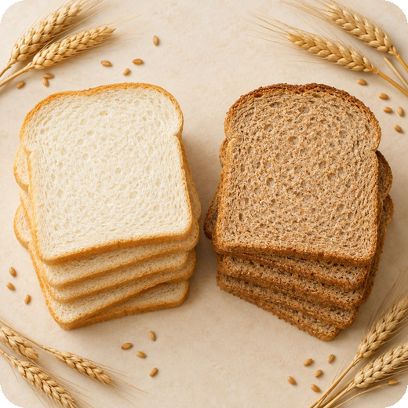<br />
<b>Pick your bread</b><br />
Plain white for the classic soft bite, or whole wheat for something heartier.
</td>
<td width="33%" valign="top">
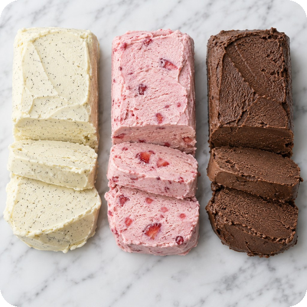<br />
<b>Slice your ice cream</b><br />
Vanilla, strawberry or chocolate, hand-sliced from a block.
</td>
<td width="33%" valign="top">
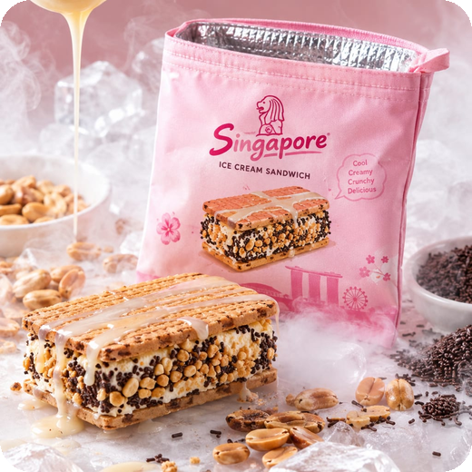<br />
<b>Pack it cold</b><br />
Every order goes into insulated foil for delivery across Jakarta.
</td>
</tr>
</table>

### Meet the sandwiches

<div align="center">
</div>


## Build it layer by layer

<div align="center">
</div>

<sub>The loop above steps through six sandwiches, from Rp 14,000 (white bread and vanilla) to Rp 21,000 (wheat bread, chocolate, both toppings).</sub>

The builder stacks a photo of every ingredient you pick and shows the result as you go. **Exploded View** pulls the layers apart, and the signature combos fill a whole sandwich in one click.

<table>
<tr><th width="33%">Bread</th><th width="33%">Ice cream</th><th width="33%">Toppings</th></tr>
<tr>
<td valign="top" align="center">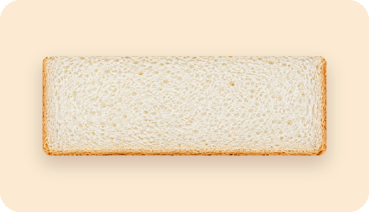<br /><b>Plain White Bread</b><br />Rp 6,000</td>
<td valign="top" align="center">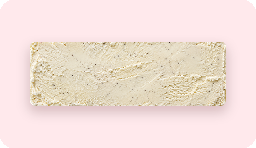<br /><b>Vanilla</b><br />Rp 8,000</td>
<td valign="top" align="center"><br /><b>Chocolate Sauce</b><br />Rp 3,000</td>
</tr>
<tr>
<td valign="top" align="center">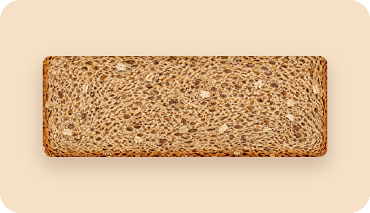<br /><b>Whole Wheat Bread</b><br />Rp 7,000</td>
<td valign="top" align="center">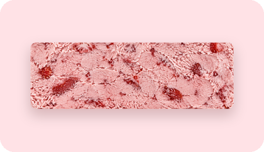<br /><b>Strawberry</b><br />Rp 8,000</td>
<td valign="top" align="center"><br /><b>Rainbow Sprinkles</b><br />Rp 3,000</td>
</tr>
<tr>
<td valign="middle" align="center"><b>24 combinations</b><br />2 breads × 3 flavors × 4 topping choices (none, either one, or both)</td>
<td valign="top" align="center">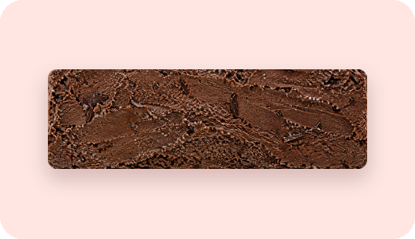<br /><b>Chocolate</b><br />Rp 8,000</td>
<td valign="middle" align="center"><b>Rp 14,000 to Rp 21,000</b><br />per sandwich at the seeded prices</td>
</tr>
</table>

A sandwich takes exactly one bread and one ice cream, and each topping at most once.

### Flavor lab

Open a flavor to see what the seeded catalog says about it.

<details>
<summary><b>Vanilla</b></summary>
<br />
<table>
<tr>
<td width="40%" valign="top">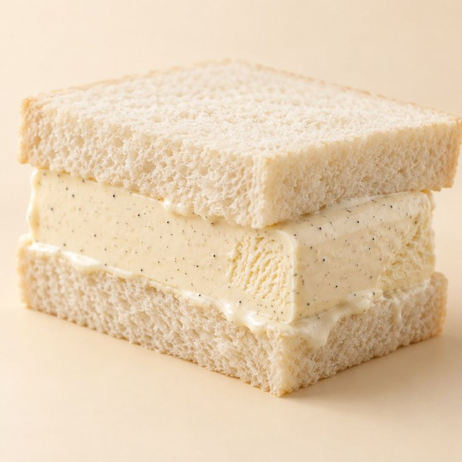</td>
<td valign="top">

Rp 8,000 per sandwich.<br />Seeded with **120** in stock and a reorder point of **40**.<br />The photo shows it on plain white bread.

</td>
</tr>
</table>
</details>

<details>
<summary><b>Strawberry</b></summary>
<br />
<table>
<tr>
<td width="40%" valign="top">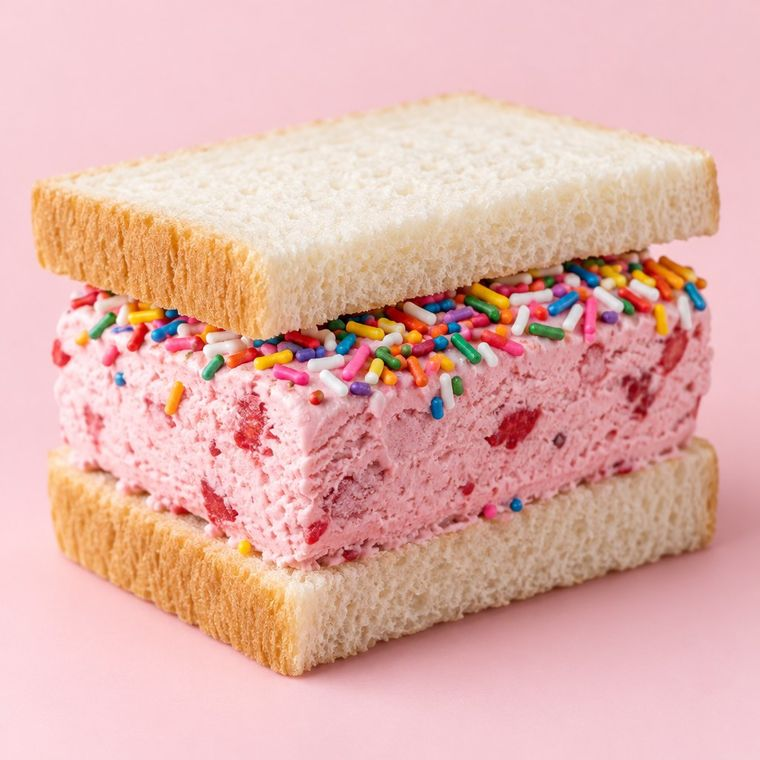</td>
<td valign="top">

Rp 8,000 per sandwich.<br />Seeded with **120** in stock and a reorder point of **40**.<br />The photo adds Rainbow Sprinkles, which are Rp 3,000 more.

</td>
</tr>
</table>
</details>

<details>
<summary><b>Chocolate</b></summary>
<br />
<table>
<tr>
<td width="40%" valign="top">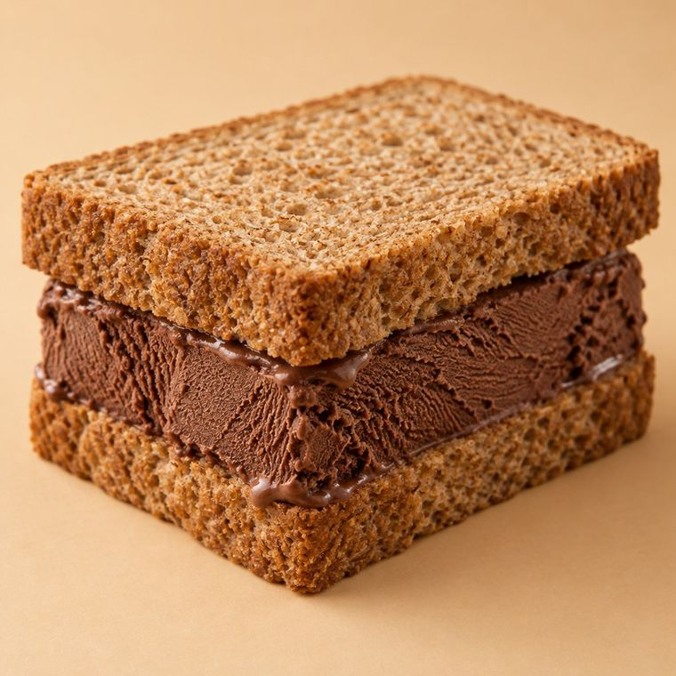</td>
<td valign="top">

Rp 8,000 per sandwich.<br />Seeded with only **35** in stock against a reorder point of **40**, so a fresh install shows a low-stock alert for it in MRP right away.<br />The photo shows it on whole wheat bread.

</td>
</tr>
</table>
</details>

<details>
<summary><b>Chocolate Sauce</b></summary>
<br />
<table>
<tr>
<td width="40%" valign="top">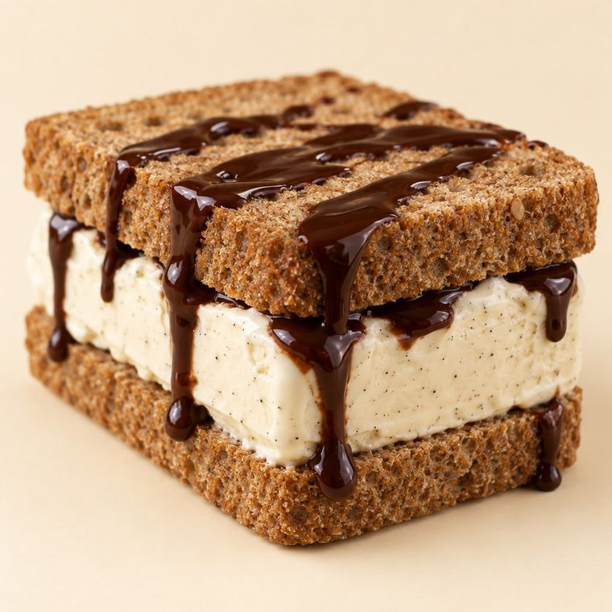</td>
<td valign="top">

A Rp 3,000 topping, seeded with **300** in stock and a reorder point of **60**.<br />Each topping can be added once, and the sauce and the sprinkles can be combined.

</td>
</tr>
</table>
</details>


## Features

### Storefront

<table>
<tr>
<td width="50%" valign="top">
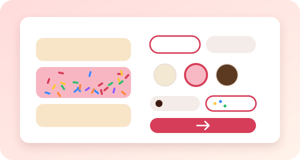<br />
&nbsp; <b>Brread! Studio</b><br />
Pick a base, a flavor and toppings, and the preview updates live. Ingredients unlock in order, so you can't build an invalid sandwich.
</td>
<td width="50%" valign="top">
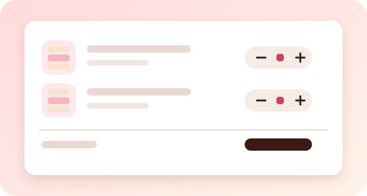<br />
&nbsp; <b>Cart and checkout</b><br />
The cart survives a page refresh. An order records the customer's name and phone number, and the server charges current prices even if the cart is older.
</td>
</tr>
</table>

Four public pages: home (`/`), the builder (`/builder`), the full menu (`/menu`) and the shop's contact details (`/contact`).

### Staff portal

<table>
<tr>
<td width="50%" valign="top">
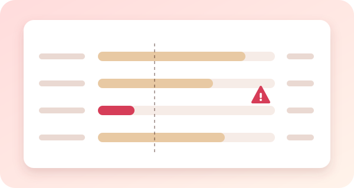<br />
&nbsp; <b>MRP, ingredient stock</b><br />
Stock levels, reorder points and low-stock alerts for every ingredient. Restock or correct a count with a note. A restock cost becomes an expense in Accounting, and every change is kept in a movement history.
</td>
<td width="50%" valign="top">
<br />
&nbsp; <b>HR, people and duty rotation</b><br />
Add, edit and deactivate employees. A fixed rotation puts 3 active employees on duty for 3 days at a time and wraps around the list, so adding or reordering staff reshapes the schedule immediately.
</td>
</tr>
<tr>
<td width="50%" valign="top">
<br />
&nbsp; <b>Accounting, cash flow</b><br />
Income arrives from orders, and staff log expenses by category. Choose a date range to see the opening balance, income, expenses and closing balance, then export the report and ledger to Excel.
</td>
<td width="50%" valign="top">
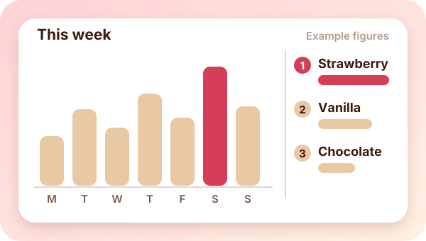<br />
&nbsp; <b>Sales, what sells</b><br />
Best-selling combinations, rankings for breads, flavors and toppings (including the ones that never sold), trends by day, week or month against the previous period, and the busiest days and hours. Admin only.
</td>
</tr>
</table>


## What happens at checkout

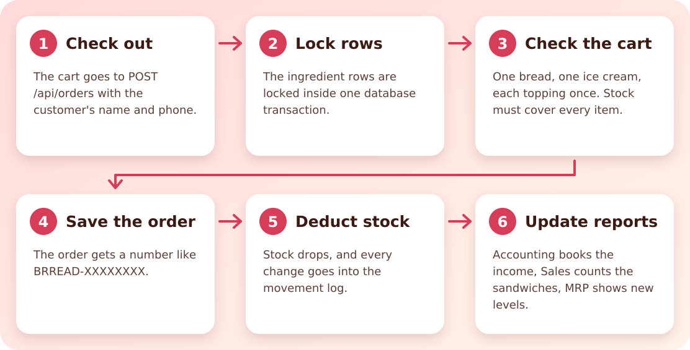

The ingredient rows stay locked for the whole database transaction, so two customers racing for the last unit can't both get it. If an ingredient runs short, the customer sees how many are left. The order endpoint accepts 30 requests per minute per IP address, and the login forms accept 10 attempts per minute per username and IP address.


## Staff manual

### Sign in

| Portal | Address | Accounts |
|---|---|---|
| Staff | `/staff` | `staffmrp` (MRP), `staffhr` (HR), `staffacc` (Accounting) |
| Admin | `/admin` | `admin` |

Staff and admins use separate login pages, and an account only works on its own page. The seeded staff passwords are in [`docs/STAFF_LOGIN_GUIDE.md`](./docs/STAFF_LOGIN_GUIDE.md), and the admin password comes from the maintainer.

On `/admin`, a one-click admin login appears when `APP_ENV=local`. It stays off everywhere else unless someone sets `ADMIN_QUICK_LOGIN=true` on purpose, because anyone who can open the page would become an admin.

### What each role can open

| | &nbsp; MRP | &nbsp; HR | &nbsp; Accounting | &nbsp; Sales |
|---|:---:|:---:|:---:|:---:|
| &nbsp; **Admin** |  |  |  |  |
| **MRP staff** |  | | | |
| **HR staff** | |  | | |
| **Accounting staff** | | |  | |

The sidebar lists only the modules your role can open, and the URL of any other module returns a 403.

### Modules

<details>
<summary><b>MRP</b>: ingredient stock at <code>/staff/mrp</code></summary>

<br />

- The dashboard shows each ingredient's stock level, category, reorder point and status.
- A low-stock alert appears when an ingredient reaches its minimum.
- To restock or correct a count, adjust the stock and write a note. If you enter a restock cost, it is booked as an expense in Accounting.
- The full history of stock movements is at `/staff/mrp/movements`.
- Customer orders deduct stock automatically at checkout, so you never subtract those by hand.

</details>

<details>
<summary><b>HR</b>: employees and duty rotation at <code>/staff/hr</code></summary>

<br />

- Add, edit and deactivate employees from the directory.
- The duty rotation puts 3 active employees on shift for 3 days at a time. It follows the rotation order, so deactivating or reordering someone changes the schedule right away.

</details>

<details>
<summary><b>Accounting</b>: cash flow at <code>/staff/accounting</code></summary>

<br />

- Customer orders appear as money in, and the expenses you log appear as money out.
- To log an expense, pick a category: Ingredients, Utilities, Salaries, Equipment, Rent or Other. You can delete an expense you entered by mistake.
- Choose a date range to see the opening balance, income, expenses, closing balance and expenses by category.
- Export the report and ledger to an `.xlsx` file.

</details>

<details>
<summary><b>Sales</b>: what sells at <code>/staff/sales</code> (admin only)</summary>

<br />

- Best-selling combinations of flavor, bread and topping.
- Rankings for flavors, breads and toppings, including the ones that haven't sold yet.
- Sandwiches sold and revenue per day, week or month, compared with the previous period.
- The busiest days and hours.

</details>


## Tech stack

<b>Backend</b><br />
   

<b>Frontend</b><br />
    

<b>Data</b><br />
  

<b>Quality</b><br />
 

<b>Deploy</b><br />


The Dockerfile builds the assets, migrates, seeds and serves the app.


## Run it locally

You need PHP 8.3 with the `sqlite`, `zip` and `gd` extensions, Composer 2 and Node.js 22.

<div align="center">

</div>

The same commands, ready to copy:

```bash
git clone https://github.com/vassellenha/KWU-BRREAD.git
cd KWU-BRREAD

composer install
npm install
cp .env.example .env
php artisan key:generate

touch database/database.sqlite
php artisan migrate --seed
npm run build

php artisan serve
```

| | |
|---|---|
| Storefront | http://127.0.0.1:8000 |
| Staff portal | http://127.0.0.1:8000/staff |
| Admin portal | http://127.0.0.1:8000/admin |

While you work on the frontend, run `npm run dev` in a second terminal instead of `npm run build`.


## Run it with Docker

```bash
docker build -t brread .
docker run -p 8080:8080 -e APP_KEY="base64:$(openssl rand -base64 32)" brread
```

Open http://localhost:8080. The container migrates and seeds the database every time it starts, and it listens on the port in the `PORT` variable (8080 by default). The data lives in a SQLite file inside the container, so it resets when you replace the container.


## Tests

```bash
php artisan test
```

The feature tests cover both login portals, role access, ordering with stock deduction, and the MRP, HR, accounting and sales modules.


## Project layout

```text
app/
  Http/Controllers/Api/      public API: components and orders
  Http/Controllers/Staff/    login and the MRP, HR, accounting and sales modules
  Models/                    Component, Order, OrderItem, StockMovement, Employee, Expense, User
  Services/                  CashflowExporter, SalesReport, ShiftScheduler
database/                    migrations and seeders
resources/views/             storefront pages, staff portal, shared partials
routes/                      web.php and api.php
docs/                        staff guide
tests/                       feature and unit tests
```


## Author

Built by [Vassell Enha Atthayya](https://github.com/vassellenha).

<div align="center">

</div>
